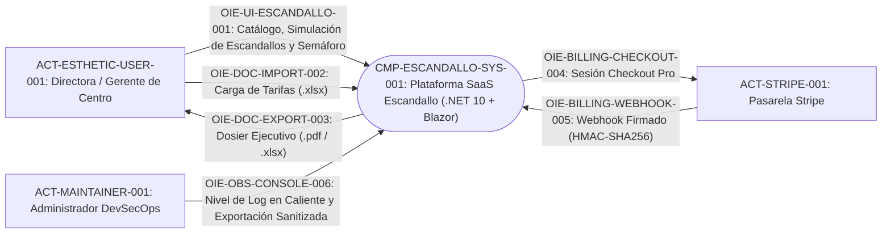
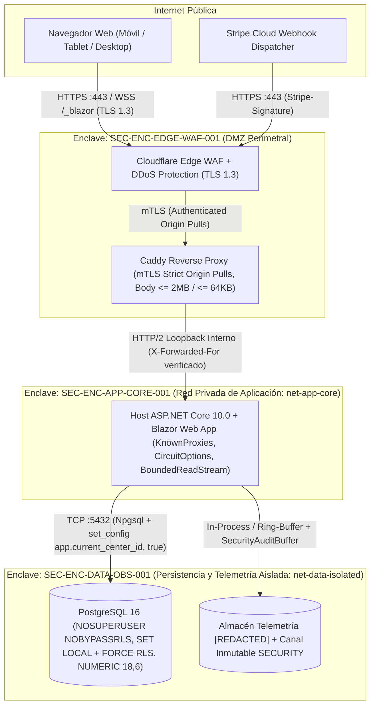

# 03. Contexto y Alcance del Sistema (arc42 Sec. 3 / NAF Operational)

## 1. Contexto de Negocio

Modela las fronteras conceptuales de la plataforma **Escandallo SaaS (`CMP-ESCANDALLO-SYS-001`)** respecto a sus actores humanos y sistemas externos colaboradores.

### 1.1 Diagrama de Contexto de Negocio

### 1.2 Intercambios de Información Operativa (`OIE-*`)

| ID Intercambio | Origen $\rightarrow$ Destino | Payload / Mensaje de Negocio | Protocolo / Canal | Formato y Controles |
| :--- | :--- | :--- | :--- | :--- |
| `OIE-UI-ESCANDALLO-001` | `ACT-ESTHETIC-USER-001` $\leftrightarrow$ `CMP-ESCANDALLO-SYS-001` | Gestión de catálogo, constructor interactivo de escandallos, previsualización M3 y recálculo en cascada | HTTPS / WSS (Blazor SSR + SignalR Circuit `/_blazor`) | HTML5 Semántico WCAG 2.1 AA; revalidación `AuthenticationStateProvider` en servidor, máx. `5` circuitos WSS/usuario (`<= 32 KB` msg), `<= 100` líneas/servicio y `30` mutaciones/min (`SEC-REQ-TENANT-001`, `SEC-REQ-DOS-001`) |
| `OIE-DOC-IMPORT-002` | `ACT-ESTHETIC-USER-001` $\rightarrow$ `CMP-ESCANDALLO-SYS-001` | Archivo de catálogo de costes de proveedores | HTTPS `multipart/form-data` | `.xlsx` ($\le 2\text{ MB}$ comprimido, `0x504B0304`, $\le 64$ entradas, ratio $\le 20:1$, `BoundedReadStream` $\le 10\text{ MB}$ reales, $\le 5.000$ filas, sin DTD/XXE y guardas `System.Decimal`, `SEC-REQ-XLSX-001`) |
| `OIE-DOC-EXPORT-003` | `CMP-ESCANDALLO-SYS-001` $\rightarrow$ `ACT-ESTHETIC-USER-001` | Informe ejecutivo de rentabilidad por tratamiento o catálogo | HTTPS Stream Download | `.pdf` (`PDFsharp`) y `.xlsx` (`ClosedXML`) sobre `RecyclableMemoryStream`, con `SemaphoreSlim(2, 2)`, máx. `10 exp/min`, timeout `10 s` y escape DDE (`TrimStart` + `'` + `XLDataType.Text`, `SEC-REQ-DOS-001`, `SEC-REQ-XLSX-001`) |
| `OIE-BILLING-CHECKOUT-004` | `CMP-ESCANDALLO-SYS-001` $\rightarrow$ `ACT-STRIPE-001` | Creación de sesión de pago `Checkout Session` con metadato inmutable `center_id` | HTTPS REST API (TLS 1.3) | JSON (`Stripe.net` SDK `MIT`) con `metadata.center_id` validado e inyectado en servidor vía `ITenantIsolationGuard` (`SEC-REQ-BILLING-001`) |
| `OIE-BILLING-WEBHOOK-005` | `ACT-STRIPE-001` $\rightarrow$ `CMP-ESCANDALLO-SYS-001` | Eventos asíncronos `checkout.session.completed`, `invoice.paid`, `customer.subscription.deleted` | HTTPS POST `/api/v1/billing/webhooks/stripe` | Stream JSON crudo ($\le 64\text{ KB}$) + `Stripe-Signature` (`HMAC-SHA256`, ventana $\le 300\text{ s}$) + tabla `stripe_webhook_events` con transición monótona (`SEC-REQ-BILLING-001`) |
| `OIE-OBS-CONSOLE-006` | `ACT-MAINTAINER-001` $\leftrightarrow$ `CMP-ESCANDALLO-SYS-001` | Conmutación de nivel de log (`DEBUG`..`SECURITY`) y descarga de telemetría | HTTPS REST / Blazor Admin UI (`[Authorize(Roles="Maintainer")]`) | JSON una línea / CSV / OTLP con `ToMaximumDepth(3)`, filtro `[REDACTED]` sobre propiedades y `Exception.Message`, y canal `SECURITY` anti-evicción (`SEC-REQ-OBS-001`) |

---

## 2. Contexto Técnico e Infraestructura Perimetral

Modela la segmentación física y lógica en tres enclaves de seguridad (`SEC-ENC-*`) definidos en el modelo de amenazas:

### 2.1 Diagrama de Contexto Técnico y Enclaves de Red

---

## 3. Historial de Revisiones y Control de Versiones

| Versión | Fecha | Autor / Agente | Descripción del Cambio | Referencia (Change/PR) |
| :--- | :--- | :--- | :--- | :--- |
| **1.0.0** | 2026-04-12 | `agent-system-architect` | Definición inicial de contexto de negocio, técnico y enclaves `SEC-ENC-*` | `chg-001-escandallo-mvp` |
| **1.1.0** | 2026-10-08 | `agent-system-architect` | Incorporación de controles técnicos v1.1.0 en intercambios `OIE-*` y enclaves `SEC-ENC-*` | `chg-001-escandallo-mvp` |
