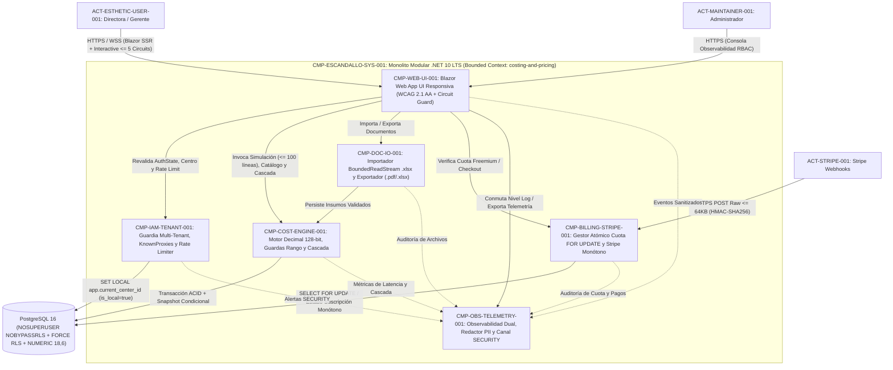

# 05. Vista de Bloques de Construcción: Nivel 1 Caja Blanca (arc42 Sec. 5 / NAF Services & Systems)

## 1. Descomposición General del Sistema (Nivel 1 y Nivel 2)

El sistema raíz **`CMP-ESCANDALLO-SYS-001`** se estructura como un **Monolito Modular Hexagonal en .NET 10 LTS** dentro del Bounded Context canónico `costing-and-pricing` (`TERM-ESCANDALLO-001`), compuesto por seis subsistemas/módulos de Nivel 2 claramente desacoplados mediante interfaces C#.

### 1.1 Diagrama de Caja Blanca (Nivel 1 $\rightarrow$ Nivel 2)

---

## 2. Catálogo de Componentes de Arquitectura (`CMP-*`)

| Bounded Context | ID de Componente | Nivel | Tipo Implementación | Enclave | Responsabilidad Principal y Fichero de Especificación |
| :--- | :--- | :---: | :---: | :--- | :--- |
| `costing-and-pricing` | [`CMP-ESCANDALLO-SYS-001`](file:///c:/Users/reypo/Documents/Workspace/Escandallo/specs/architecture/components/cmp-escandallo-sys-001.md) | 1 | `composite` | `SEC-ENC-APP-CORE-001` | Sistema raíz del Monolito Modular .NET 10 LTS de Escandallos para Centros de Estética. |
| `costing-and-pricing` | [`CMP-WEB-UI-001`](file:///c:/Users/reypo/Documents/Workspace/Escandallo/specs/architecture/components/cmp-web-ui-001.md) | 2 | `service` | `SEC-ENC-APP-CORE-001` | Interfaz web adaptativa en **Blazor Web App** (SSR + Interactive acotado a $\le 5$ circuitos/usuario), revalidación de parámetros en servidor y accesibilidad WCAG 2.1 AA. |
| `costing-and-pricing` | [`CMP-IAM-TENANT-001`](file:///c:/Users/reypo/Documents/Workspace/Escandallo/specs/architecture/components/cmp-iam-tenant-001.md) | 2 | `service` | `SEC-ENC-APP-CORE-001` | Autenticación anti-Overposting, autorización multi-centro (`ITenantIsolationGuard` + `SET LOCAL`), copia dual (M4), `KnownProxies` y `RateLimiter` (`30 mut/m`, `10 exp/m`). |
| `costing-and-pricing` | [`CMP-COST-ENGINE-001`](file:///c:/Users/reypo/Documents/Workspace/Escandallo/specs/architecture/components/cmp-cost-engine-001.md) | 2 | `dll` | `SEC-ENC-APP-CORE-001` | Librería de dominio puro C# con aritmética `System.Decimal` (128 bits), guardas anti-`OverflowException`, cota de `100` líneas/servicio y recálculo síncrono en cascada. |
| `costing-and-pricing` | [`CMP-DOC-IO-001`](file:///c:/Users/reypo/Documents/Workspace/Escandallo/specs/architecture/components/cmp-doc-io-001.md) | 2 | `service` | `SEC-ENC-APP-CORE-001` | Importador `.xlsx` con `BoundedReadStream` ($\le 10\text{ MB}$ reales), anti-XXE y anti-DDE (`XLDataType.Text`), y exportador `.pdf`/`.xlsx` sobre `RecyclableMemoryStream` (`SemaphoreSlim(2, 2)`). |
| `costing-and-pricing` | [`CMP-BILLING-STRIPE-001`](file:///c:/Users/reypo/Documents/Workspace/Escandallo/specs/architecture/components/cmp-billing-stripe-001.md) | 2 | `service` | `SEC-ENC-APP-CORE-001` | Control atómico de cuota Freemium (`<= 2` activos con `SELECT ... FOR UPDATE`), vinculación en servidor de `metadata.center_id` y webhooks Stripe sobre stream crudo ($\le 64\text{ KB}$) con idempotencia monótona. |
| `costing-and-pricing` | [`CMP-OBS-TELEMETRY-001`](file:///c:/Users/reypo/Documents/Workspace/Escandallo/specs/architecture/components/cmp-obs-telemetry-001.md) | 2 | `service` | `SEC-ENC-DATA-OBS-001` | Subsistema dual `Serilog` + `OpenTelemetry .NET` con `LoggingLevelSwitch`, `ToMaximumDepth(3)`, redacción `[REDACTED]` en propiedades y `Exception.Message`, y canal `SECURITY` anti-evicción. |

---

## 3. Trazabilidad de Requisitos por Componente (360° RTM Midstream)

| Componente | Casos de Uso Implementados (`UC-*`) | Requisitos Satisfechos (`FR-*`, `QR-*`, `SEC-REQ-*`) |
| :--- | :--- | :--- |
| `CMP-ESCANDALLO-SYS-001` | Todos (`UC-COST-CATALOG-001` .. `UC-OBSERVABILITY-001`) | Todos (`FR-*`, `QR-*`, `SEC-REQ-*`) |
| `CMP-WEB-UI-001` | `UC-COST-CATALOG-001`, `UC-ESCANDALLO-CALC-001`, `UC-EXEC-REPORT-001`, `UC-SUBSCRIPTION-001`, `UC-OBSERVABILITY-001` | `QR-UI-A11Y-001`, `QR-SEC-001`, `FR-TENANT-001`, `FR-COST-001`, `FR-CALC-001`, `FR-HIST-001`, `FR-REPORT-001`, `FR-BILLING-001`, `FR-OBS-001`, `SEC-REQ-TENANT-001`, `SEC-REQ-DOS-001`, `SEC-REQ-OBS-001` |
| `CMP-IAM-TENANT-001` | `UC-COST-CATALOG-001`, `UC-ESCANDALLO-CALC-001`, `UC-EXEC-REPORT-001`, `UC-SUBSCRIPTION-001`, `UC-OBSERVABILITY-001` | `FR-TENANT-001`, `QR-SEC-001`, `SEC-REQ-TENANT-001`, `SEC-REQ-DOS-001`, `SEC-REQ-OBS-001` |
| `CMP-COST-ENGINE-001` | `UC-COST-CATALOG-001`, `UC-ESCANDALLO-CALC-001` | `FR-COST-001`, `FR-CALC-001`, `FR-HIST-001`, `SEC-REQ-DOS-001`, `SEC-REQ-XLSX-001` |
| `CMP-DOC-IO-001` | `UC-COST-CATALOG-001`, `UC-EXEC-REPORT-001` | `FR-COST-001`, `FR-REPORT-001`, `SEC-REQ-XLSX-001`, `SEC-REQ-DOS-001`, `SEC-REQ-TENANT-001` |
| `CMP-BILLING-STRIPE-001` | `UC-SUBSCRIPTION-001`, `UC-ESCANDALLO-CALC-001`, `UC-EXEC-REPORT-001` | `FR-BILLING-001`, `QR-SEC-001`, `SEC-REQ-BILLING-001` |
| `CMP-OBS-TELEMETRY-001` | `UC-OBSERVABILITY-001` | `FR-OBS-001`, `QR-SEC-001`, `SEC-REQ-OBS-001` |

---

## 4. Historial de Revisiones y Control de Versiones

| Versión | Fecha | Autor / Agente | Descripción del Cambio | Referencia (Change/PR) |
| :--- | :--- | :--- | :--- | :--- |
| **1.0.0** | 2026-10-08 | `agent-system-architect` | Descomposición de Nivel 1 y Nivel 2 del Monolito Modular .NET 10 LTS + Blazor | `chg-001-escandallo-mvp` |
| **1.1.0** | 2026-10-08 | `agent-system-architect` | Actualización de responsabilidades y matriz RTM 360° con los requisitos `SEC-REQ-*` v1.1.0 | `chg-001-escandallo-mvp` |
