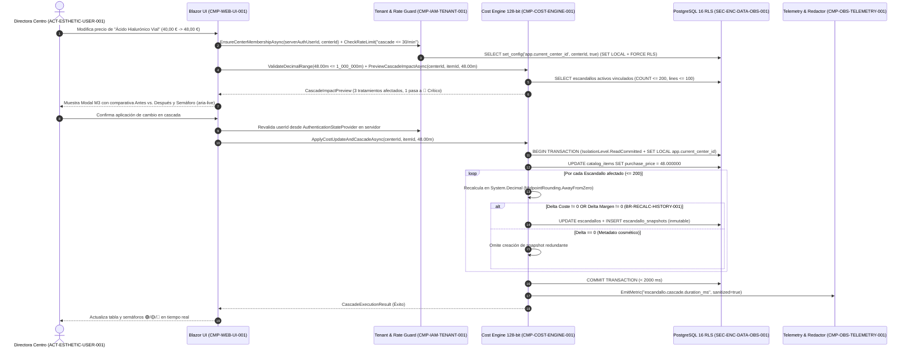

# 06. Vista en Tiempo de Ejecución (arc42 Sec. 6 / NAF Behaviour)

## 1. Escenario Nominal 1: Actualización de Coste con Previsualización (M3) y Recálculo Transaccional en Cascada (`SEQ-CASCADE-RECALC-001`)

Modela el flujo interactivo en **Blazor** cuando la directora del centro (`ACT-ESTHETIC-USER-001`) actualiza el precio de compra de un insumo en el catálogo (`UC-COST-CATALOG-001`, `UC-ESCANDALLO-CALC-001`), revalidando `AuthenticationStateProvider` en servidor (`SEC-REQ-TENANT-001`), verificando guardas de rango en `System.Decimal` (`SEC-REQ-XLSX-001`), aplicando el límite anti-DoS (`<= 30 mutaciones/min`, `<= 200` escandallos vinculados, `<= 100` líneas/servicio, `SEC-REQ-DOS-001`) y generando instantáneas históricas solo si existe variación matemática ($\Delta \text{Coste} \ne 0 \lor \Delta \text{Margen} \ne 0$, `BR-RECALC-HISTORY-001`).



---

## 2. Escenario de Seguridad y Monetización: Bloqueo Atómico de Cuota Freemium y Webhook Idempotente de Stripe (`SEQ-FREEMIUM-STRIPE-002`)

Modela la prevención de condiciones de carrera TOCTOU multi-circuito (`ABUSE-QUOTA-BYPASS-001`) al intentar crear, duplicar (`M4`) o desarchivar (`M1`) un 3.er escandallo activo en el plan gratuito (`BR-FREEMIUM-QUOTA-001`), la vinculación en servidor de `metadata.center_id` y la activación segura del plan Pro vía webhook firmado sobre stream crudo (`<= 64 KB`) con idempotencia monótona (`SEC-REQ-BILLING-001`).

```mermaid
sequenceDiagram
    autonumber
    actor User as Directora Centro (ACT-ESTHETIC-USER-001)
    participant UI as Blazor UI (CMP-WEB-UI-001)
    participant Guard as Tenant Guard (CMP-IAM-TENANT-001)
    participant Billing as Billing & Quota (CMP-BILLING-STRIPE-001)
    participant DB as PostgreSQL 16 (SEC-ENC-DATA-OBS-001)
    actor Stripe as Pasarela Stripe (ACT-STRIPE-001)
    participant Obs as Telemetry (CMP-OBS-TELEMETRY-001)

    User->>UI: Solicita crear, duplicar (M4) o desarchivar (M1) el 3.er escandallo activo
    UI->>Billing: TryAcquireActiveEscandalloSlotAsync(centerId)
    Billing->>DB: BEGIN TX; SELECT subscription_tier FROM centers WHERE id = centerId FOR UPDATE
    Billing->>DB: SELECT COUNT(*) FROM escandallos WHERE center_id = centerId AND status = 'active'
    alt Plan == 'Free' AND ActiveCount >= 2
        Billing->>DB: ROLLBACK TX
        Billing->>Obs: LogSecurity("FreemiumQuotaConcurrentOverflowAttempt", centerId)
        Billing-->>UI: 402 Payment Required / QuotaExceededResult
        UI-->>User: Presenta FreemiumPaywallModal (Archivar uno existente o Suscribirse a Pro)
    end
    User->>UI: Pulsa "Actualizar a Plan Pro"
    UI->>Guard: EnsureCenterMembershipAsync(serverAuthUserId, centerId)
    UI->>Billing: CreateStripeCheckoutSessionAsync(centerId, serverAuthUserId) (Inyecta metadata.center_id en servidor)
    Billing-->>UI: Redirect URL a Stripe Checkout
    Stripe->>Billing: POST /api/v1/billing/webhooks/stripe (Raw Stream <= 64 KB + Stripe-Signature)
    Billing->>Billing: EventUtility.ConstructEvent(rawBody, sigHeader, secret, tolerance=300s)
    alt Firma Inválida, Payload Alterado o Timestamp > 300s
        Billing->>Obs: LogSecurity("StripeWebhookSignatureFailed", "[REDACTED]")
        Billing-->>Stripe: 400 Bad Request
    else Firma HMAC-SHA256 Válida
        Billing->>DB: BEGIN TX; INSERT INTO stripe_webhook_events(event_id, center_id, event_created_at) ON CONFLICT DO NOTHING
        Billing->>DB: UPDATE centers SET subscription_tier = 'Pro' WHERE id = metadata.center_id AND last_event_at <= event.Created (Monótono)
        Billing->>DB: COMMIT TX
        Billing-->>Stripe: 200 OK
    end
```

---

## 3. Escenario Defensivo: Importación `.xlsx` con Inspección `BoundedReadStream`, Anti-XXE y Sanitización DDE (`SEQ-SAFE-XLSX-IMPORT-003`)

Modela la mitigación en profundidad contra archivos Excel maliciosos con cabeceras ZIP falsificadas, entidades externas XXE, inyección de fórmulas con espacios iniciales y desbordamientos en `System.Decimal` (`ABUSE-XLSX-INJECT-001`, `SEC-REQ-XLSX-001`):

```mermaid
sequenceDiagram
    autonumber
    actor Attacker as Actor / Usuario (ACT-ESTHETIC-USER-001 / ACT-THREAT-EXT-001)
    participant DocIO as Safe Document IO (CMP-DOC-IO-001)
    participant Engine as Cost Engine (CMP-COST-ENGINE-001)
    participant Obs as Telemetry (CMP-OBS-TELEMETRY-001)

    Attacker->>DocIO: Sube archivo catálogo (.xlsx stream)
    DocIO->>DocIO: Verifica tamaño comprimido <= 2 MB, Magic Bytes 0x504B0304, <= 64 entradas y ratio <= 20:1
    DocIO->>DocIO: Descomprime mediante BoundedReadStream (RecyclableMemoryStream) y XmlReader (DtdProcessing.Prohibit)
    alt Bytes reales descomprimidos > 10 MB (Header Spoofing) OR DTD/XXE detectado OR > 5000 filas
        DocIO->>Obs: LogSecurity("XlsxSecurityViolation", reason, centerId)
        DocIO-->>Attacker: 422 Unprocessable Entity (Aborta inmediatamente)
    else Archivo ZIP Seguro y <= 5000 Filas
        DocIO->>DocIO: Inspecciona celdas tras TrimStart(); si inicia con =,+,-,@,\t,\r antepone "'" y fija XLDataType.Text
        DocIO->>Engine: UpsertValidatedCatalogItemsAsync(centerId, sanitizedRows)
        alt Valor numérico NaN/Negativo/Cero o fuera de rango (PurchasePrice > 1_000_000m)
            Engine->>Obs: LogSecurity("DecimalOverflowOrInvalidInputAttempt", centerId)
            Engine-->>DocIO: 422 Unprocessable Entity
            DocIO-->>Attacker: 422 Unprocessable Entity
        else Valores en rango System.Decimal (128-bit)
            Engine-->>DocIO: Resumen de importación (Insertados / Actualizados)
            DocIO-->>Attacker: 200 OK con reporte de importación
        end
    end
```

---

## 4. Matriz de Escenarios Dinámicos y Requisitos Asociados

| ID Escenario | Tipo | Requisitos Satisfechos | Componentes Participantes |
| :--- | :---: | :--- | :--- |
| `SEQ-CASCADE-RECALC-001` | Nominal / Rendimiento | `FR-COST-001`, `FR-CALC-001`, `FR-HIST-001`, `QR-UI-A11Y-001`, `SEC-REQ-TENANT-001`, `SEC-REQ-DOS-001`, `SEC-REQ-XLSX-001` | `CMP-WEB-UI-001`, `CMP-IAM-TENANT-001`, `CMP-COST-ENGINE-001`, `CMP-OBS-TELEMETRY-001` |
| `SEQ-FREEMIUM-STRIPE-002` | Seguridad / Negocio | `FR-BILLING-001`, `FR-TENANT-001`, `QR-SEC-001`, `SEC-REQ-BILLING-001`, `SEC-REQ-TENANT-001`, `SEC-REQ-OBS-001` | `CMP-WEB-UI-001`, `CMP-IAM-TENANT-001`, `CMP-BILLING-STRIPE-001`, `CMP-OBS-TELEMETRY-001` |
| `SEQ-SAFE-XLSX-IMPORT-003` | Seguridad Defensiva | `FR-COST-001`, `FR-REPORT-001`, `SEC-REQ-XLSX-001`, `SEC-REQ-DOS-001`, `SEC-REQ-OBS-001` | `CMP-DOC-IO-001`, `CMP-COST-ENGINE-001`, `CMP-OBS-TELEMETRY-001` |

---

## 5. Historial de Revisiones y Control de Versiones

| Versión | Fecha | Autor / Agente | Descripción del Cambio | Referencia (Change/PR) |
| :--- | :--- | :--- | :--- | :--- |
| **1.0.0** | 2026-04-12 | `agent-system-architect` | Definición inicial de vistas dinámicas y secuencias de ejecución | `chg-001-escandallo-mvp` |
| **1.1.0** | 2026-10-08 | `agent-system-architect` | Incorporación de pasos de validación `SEC-REQ-*` v1.1.0 en los 3 diagramas de secuencia | `chg-001-escandallo-mvp` |
