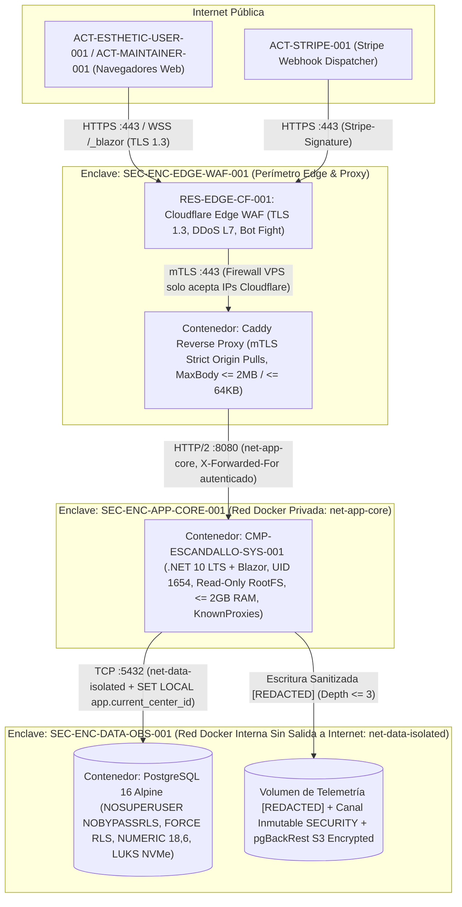

# 07. Vista de Despliegue e Infraestructura Rentable (arc42 Sec. 7 / NAF Resource Deployment)

## 1. Recomendación de Despliegue Más Rentable (Análisis FinOps & TCO)

Para maximizar el margen neto de un SaaS B2B vertical dirigido a centros de estética (con suscripción Pro estimada en `14,90 € - 29,00 €/mes` y capa Freemium de hasta 2 escandallos activos), **se desaconseja rotundamente** el uso inicial de clústeres Kubernetes gestionados (AKS/EKS) o bases de datos PaaS hiperescalares sobredimensionadas (Azure SQL / AWS RDS Multi-AZ), cuyo suelo fijo supera los `120 € - 250 €/mes` antes del primer cliente.

En su lugar, aprovechando la extraordinaria eficiencia de memoria y CPU de **ASP.NET Core 10.0 (Kestrel + Blazor Web App)** compilado para Linux (`linux-x64` / `linux-arm64`), se establece una **Topología de Monolito Modular Contenerizado en Cloud Europeo (Hetzner Cloud EU - Falkenstein/Nuremberg) protegida por Cloudflare Edge WAF**:

### 1.1 Comparativa Económica de Opciones de Despliegue (Capacidad: 1 a 500 Centros Activos)

| Opción de Infraestructura | Arquitectura de Recursos | Coste Fijo Mensual (EUR) | Break-Even (Clientes Pro a 14,90 €) | Veredicto Arquitectónico |
| :--- | :--- | :---: | :---: | :--- |
| **Opción A (Recomendada - Fase 1 MVP/Tracción)** | **Cloudflare Edge WAF (Free) + Hetzner Cloud CX22/CPX21 (4 vCPU, 8 GB RAM, 80 GB NVMe, EU) + Docker Compose (Caddy + .NET 10 LTS + PostgreSQL 16 + Backups S3 cifrados)** | **~6,50 € – 9,90 € / mes** | **1 cliente de pago** | **ÓPTIMA**: Latencia `< 15 ms` en Europa, 100% RGPD, aislamiento por redes Docker e inversión fija mínima. |
| **Opción B (Escala Media - Fase 2 > 500 Centros)** | **Cloudflare Pro WAF + 2 Nodos VPS App (.NET 10 Stateless) + PostgreSQL 16 Gestionado / Nodo Dedicado con Réplica** | **~35,00 € – 55,00 € / mes** | **3 a 4 clientes de pago** | **EVOLUCIÓN NATURAL**: Migración sin cambio de código gracias al diseño de Monolito Modular (`ADR-001-COST-EFFECTIVE-DEPLOYMENT`). |
| **Opción C (Descartada por Sobrecoste)** | Azure App Service P1v3 + Azure Database for PostgreSQL Flexible Server + Azure Front Door WAF | ~185,00 € – 260,00 € / mes | 15 a 18 clientes de pago | **DESCARTADA**: Penaliza la caja inicial en un 2.500% sin aportar ventajas funcionales sobre `.NET 10` en contenedor Linux. |

---

## 2. Topología de Infraestructura y Enclaves de Red (`SEC-ENC-*`)

---

## 3. Inventario de Nodos y Recursos de Ejecución (`RES-*`)

| ID Recurso | Tipo de Nodo / Contenedor | Enclave Asociado | CPU / RAM Asignada | Componentes Desplegados |
| :--- | :--- | :--- | :--- | :--- |
| `RES-EDGE-CF-001` | Red Anycast Global (Cloudflare) | `SEC-ENC-EDGE-WAF-001` | Edge Elástico | Reglas OWASP Core Rule Set, HSTS, limitación perimetral y certificado TLS 1.3. |
| `RES-VPS-EU-001` | Servidor Cloud Linux Ubuntu 24.04 LTS (Hetzner EU) | `SEC-ENC-APP-CORE-001` / `SEC-ENC-DATA-OBS-001` | 4 vCPU / 8 GB RAM / 80 GB NVMe | Host Docker endurecido (`ufw` cerrando todo salvo `:443` desde Cloudflare + mTLS Caddy): `CMP-ESCANDALLO-SYS-001` (límite `2 GB` RAM) + `PostgreSQL 16` (límite `3 GB` RAM). |
| `RES-STORAGE-BACKUP-001` | Object Storage S3 Europeo (Hetzner / Backblaze B2 EU) | `SEC-ENC-DATA-OBS-001` | Almacenamiento frío cifrado (`AES-256-GCM`) | Snapshots diarios automatizados de PostgreSQL (`pg_dump`/`pgBackRest`) con retención de 30 días (`~0,50 €/mes`). |

---

## 4. Políticas de Red, Endurecimiento de Contenedores y Aislamiento (`SEC-ENC-*`, `SEC-REQ-*`)

- **Aislamiento de Origen mTLS y Anti-Spoofing de IP (`SEC-ENC-EDGE-WAF-001`, `SEC-REQ-DOS-001`)**: Firewall `ufw` cerrado salvo `:443` desde rangos oficiales de Cloudflare con verificación obligatoria de certificado cliente mTLS (*Authenticated Origin Pulls*) en Caddy, y configuración de `ForwardedHeadersMiddleware` en ASP.NET Core 10 confiando únicamente en el proxy Caddy interno (`KnownProxies`) para impedir la falsificación de `X-Forwarded-For` / `CF-Connecting-IP`.
- **Cierre Total de Puertos de Base de Datos y Rol `NOBYPASSRLS` (`SEC-ENC-DATA-OBS-001`, `SEC-REQ-TENANT-001`)**: El contenedor de PostgreSQL 16 reside exclusivamente en la red bridge interna `net-data-isolated` (`internal: true` en Docker Compose, `ports: []`), y la aplicación conecta con un rol sin `SUPERUSER` ni `BYPASSRLS` fijando `SET LOCAL app.current_center_id`.
- **Ejecución Sin Privilegios (`Non-Root`), `Read-Only RootFS` y Protección del LOH (`SEC-ENC-APP-CORE-001`, `SEC-REQ-DOS-001`, `SEC-REQ-XLSX-001`)**: La imagen oficial `mcr.microsoft.com/dotnet/aspnet:10.0-noble-chiseled` se ejecuta bajo `UID 1654` sin shell (`sh`/`bash`), acota los circuitos Blazor SignalR (`<= 5` por usuario, `32 KB` por mensaje) y procesa importaciones/exportaciones `.xlsx`/`.pdf` exclusivamente en memoria reutilizable (`BoundedReadStream` sobre `RecyclableMemoryStream`, $\le 10\text{ MB}$ reales) sin escribir archivos subidos en el disco del contenedor.
- **Persistencia Aislada para Auditoría `SECURITY` (`SEC-ENC-DATA-OBS-001`, `SEC-REQ-OBS-001`)**: El volumen de telemetría separa físicamente el canal inmutable de eventos `SECURITY` del ring-buffer rotativo de `DEBUG`/`INFO` para impedir la evicción forense por inundación de logs.

---

## 5. Historial de Revisiones y Control de Versiones

| Versión | Fecha | Autor / Agente | Descripción del Cambio | Referencia (Change/PR) |
| :--- | :--- | :--- | :--- | :--- |
| **1.0.0** | 2026-10-08 | `agent-system-architect` | Definición de vista de despliegue rentable (.NET 10 LTS + Blazor + Hetzner EU + Cloudflare) | `chg-001-escandallo-mvp` |
| **1.1.0** | 2026-10-08 | `agent-system-architect` | Incorporación de controles de enclaves v1.1.0 (`KnownProxies` mTLS, `NOBYPASSRLS`, `BoundedReadStream`/`RecyclableMemoryStream` y canal `SECURITY` inmutable) | `chg-001-escandallo-mvp` |
