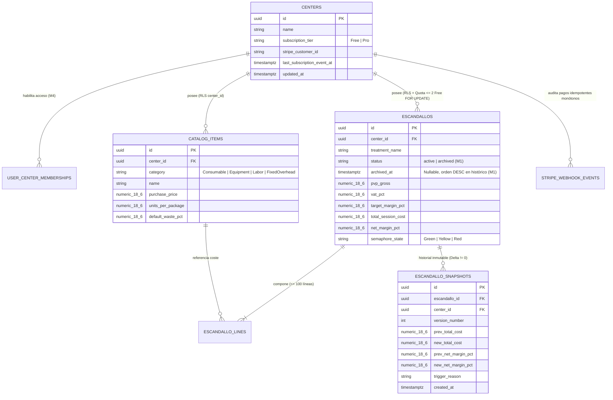

# 08. Conceptos Transversales (arc42 Sec. 8 / NAF Information & Security)

## 1. Concepto Transversal de Seguridad y Modelo Zero-Trust Multi-Tenant

### 1.1 Políticas de Seguridad Vinculantes (`SEC-POL-*`)

| ID Política | Alcance | Descripción del Control Técnico y Requisito Satisfecho |
| :--- | :--- | :--- |
| `SEC-POL-RLS-TENANT-001` | Persistencia, UI y Dominio (`CMP-IAM-TENANT-001`, `CMP-WEB-UI-001`) | Doble barrera de aislamiento por centro (`BR-TENANT-ISOLATION-001`, `SEC-REQ-TENANT-001`): (1) Revalidación continua de `userId` desde `AuthenticationStateProvider` en servidor en cada evento interactivo Blazor y clonado `M4` (`ITenantIsolationGuard`), ignorando `[Parameter]` / `[SupplyParameterFromForm]` del cliente; y (2) Rol PostgreSQL 16 `NOSUPERUSER NOBYPASSRLS` con `SELECT set_config('app.current_center_id', @centerId::text, true)` (`is_local = true`) bajo políticas `ENABLE` + `FORCE ROW LEVEL SECURITY` *fail-closed* (`RSK-RLS-POOL-LEAK-004`). |
| `SEC-POL-REDACT-OBS-002` | Observabilidad y RBAC (`CMP-OBS-TELEMETRY-001`, `CMP-WEB-UI-001`) | Bloqueo de *Mass Assignment* (`role=maintainer`) y exigencia de `[Authorize(Roles = "Maintainer")]` en servidor (`SEC-REQ-OBS-001`). En `Serilog`, límite `Destructuring.ToMaximumDepth(3)` y `ToMaximumStringLength(1024)`, redacción inmutable `[REDACTED]` (`PiiAndSecretRedactingPolicy`) tanto en propiedades estructuradas como en cadenas de conexión `Npgsql` (`Password=...`) y claves `whsec_` dentro de `Exception.Message` incluso en nivel `DEBUG`, serialización JSON de una línea escapando `\r`, `\n`, `\t`, y canal inmutable `SECURITY` anti-evicción. |
| `SEC-POL-SAFE-ZIP-003` | Ingesta Documental y Dominio (`CMP-DOC-IO-001`, `CMP-COST-ENGINE-001`) | Defensa contra Zip Bombs (incluido spoofing de cabeceras ZIP), XXE, Formula Injection y `OverflowException` (`SEC-REQ-XLSX-001`): tamaño comprimido $\le 2\text{ MB}$ (`0x504B0304`), $\le 64$ entradas ZIP, ratio $\le 20:1$, lectura vía `BoundedReadStream` sobre `RecyclableMemoryStream` abortando si los bytes reales descomprimidos superan `10 MB`, `XmlReaderSettings { DtdProcessing = DtdProcessing.Prohibit, XmlResolver = null }`, $\le 5.000$ filas, prefijo `'` + `XLDataType.Text` tras `TrimStart()` ante `=`, `+`, `-`, `@`, `\t`, `\r`, y guardas de rango en `System.Decimal`. |
| `SEC-POL-STRIPE-HMAC-004` | Facturación (`CMP-BILLING-STRIPE-001`) | Serialización transaccional `SELECT ... FOR UPDATE` sobre `centers` en toda creación, duplicación (`M4`) o transición `archived -> active` (`M1`) verificando `< 2` activos en plan Free (`SEC-REQ-BILLING-001`), vinculación en servidor de `metadata.center_id` en Checkout, validación `Stripe.EventUtility.ConstructEvent` sobre cuerpo crudo ($\le 64\text{ KB}$, `HMAC-SHA256`, ventana $\le 300\text{ s}$) e idempotencia monótona en `stripe_webhook_events(event_id PRIMARY KEY)`. |
| `SEC-POL-DOS-CIRCUIT-005` | Perímetro, UI y Exportación (`CMP-IAM-TENANT-001`, `CMP-WEB-UI-001`, `CMP-DOC-IO-001`) | Protección anti-DoS asimétrica (`SEC-REQ-DOS-001`): `ForwardedHeadersMiddleware` con `KnownProxies` (Caddy mTLS), límite de `30 mutaciones de catálogo/min` ($\le 200$ escandallos en cascada), cota de `100 líneas de coste por escandallo` (`M3`), `SemaphoreSlim(2, 2)` + `10 exportaciones/min` + timeout `10 s` con `RecyclableMemoryStream` en `.pdf`/`.xlsx`, y `CircuitOptions` en SignalR (`DisconnectedCircuitRetentionPeriod = 3 min`, `MaxBufferedUnacknowledgedRenderBatches = 10`, `MaximumReceiveMessageSize = 32 KB`, $\le 5$ circuitos/usuario). |

---

## 2. Modelos de Datos Transversales y Precisión Matemática (`DATA-*`)

| ID Modelo | Formato / Esquema | Especificación Técnica | Propósito |
| :--- | :--- | :--- | :--- |
| `DATA-REL-POSTGRES-001` | Esquema Relacional PostgreSQL 16 | Tablas `centers`, `user_center_memberships`, `catalog_items`, `escandallos`, `escandallo_lines`, `escandallo_snapshots`, `stripe_webhook_events` | Almacenamiento transaccional ACID con `NUMERIC(18,6)` y políticas `FORCE RLS` bajo rol `NOBYPASSRLS`. |
| `DATA-DEC-CALC-002` | Modelo Inmutable C# (`record struct`) | `EscandalloCalculationInput` / `EscandalloCalculationResult` con `System.Decimal` (128 bits) y guardas de rango | Evaluación determinista de fórmulas financieras (`BR-CALC-FORMULAS-001`) con redondeo comercial explícito (`MidpointRounding.AwayFromZero`) y prevención de `OverflowException`. |
| `DATA-OBS-EVENT-003` | Esquema JSON / OTLP de Telemetría | `{ timestamp, level, trace_id, span_id, component_id, tenant_hash, event_code, payload_sanitized }` | Trazabilidad dual de operaciones y canal inmutable `SECURITY` auditable desde consola de mantenimiento (`UC-OBSERVABILITY-001`). |

### 2.1 Diagrama Entidad-Relación de Dominio y Persistencia Multi-Tenant

---

## 3. Fórmulas Matemáticas Deterministas y Guardas de Rango en `System.Decimal` (`BR-CALC-FORMULAS-001`, `SEC-REQ-XLSX-001`)

Todas las operaciones en `CMP-COST-ENGINE-001` se ejecutan en `decimal` de 128 bits sin conversiones intermedias a coma flotante, previa verificación de las **guardas de rango anti-`OverflowException`** (`0m <= PurchasePrice <= 1_000_000m`, `UnitsPerPackage >= 0.0001m`, `0m <= WastePct <= 100m`, `Lines.Count <= 100`; cualquier incumplimiento devuelve HTTP `422`):
1. **Coste de Consumibles con Merma**:
   $$\text{CosteConsumibles} = \sum_{i=1}^{n} \left( \frac{\text{PrecioEnvase}_i}{\text{UnidadesEnvase}_i} \times \text{CantidadUsada}_i \times \left(1 + \frac{\text{MermaPct}_i}{100}\right) \right)$$
2. **Coste Total por Sesión**:
   $$\text{CosteTotalSesión} = \text{CosteConsumibles} + \text{AmortizaciónAparatología} + \text{CosteManoObra} + \text{GastosFijosSesión} + \text{ComisiónTPV}$$
3. **Precio Neto sin IVA y Margen Neto Real**:
   $$\text{PVPNeto} = \frac{\text{PVPBruto}}{1 + \frac{\text{IVAPct}}{100}}, \quad \text{MargenNeto (€)} = \text{PVPNeto} - \text{CosteTotalSesión}, \quad \text{MargenNeto (\%)} = \frac{\text{MargenNeto (€)}}{\text{PVPNeto}} \times 100$$
4. **Semáforo de Erosión de Margen**:
   - `🟢 Óptimo (Green)`: $\text{MargenNeto (\%)} \ge \text{MargenObjetivo (\%)}$
   - `🟡 En Riesgo (Yellow)`: $(\text{MargenObjetivo (\%)} - 10\%) \le \text{MargenNeto (\%)} < \text{MargenObjetivo (\%)}$
   - `🔴 Crítico (Red)`: $\text{MargenNeto (\%)} < (\text{MargenObjetivo (\%)} - 10\%)$ o $\text{MargenNeto (€)} \le 0$

---

## 4. Historial de Revisiones y Control de Versiones

| Versión | Fecha | Autor / Agente | Descripción del Cambio | Referencia (Change/PR) |
| :--- | :--- | :--- | :--- | :--- |
| **1.0.0** | 2026-04-12 | `agent-system-architect` | Definición inicial de conceptos transversales, modelo ER y fórmulas `decimal` | `chg-001-escandallo-mvp` |
| **1.1.0** | 2026-10-08 | `agent-system-architect` | Incorporación de `SEC-POL-DOS-CIRCUIT-005`, enriquecimiento de políticas `SEC-POL-001..004` y guardas `System.Decimal` (`SEC-REQ-*` v1.1.0) | `chg-001-escandallo-mvp` |
| **1.2.0** | 2026-10-09 | `agent-system-architect` | Inclusión del atributo `archived_at` (`timestamptz`) en `ESCANDALLOS` para ordenación descendente de servicios archivados en la sección de histórico | `chg-001-escandallo-mvp` |
