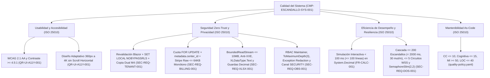

# 10. Requisitos de Calidad y Árbol de Calidad (arc42 Sec. 10 / NAF Quality)

## 1. Árbol de Calidad (ISO/IEC 25010)

Estructura jerárquica de los atributos de calidad clave del sistema vinculados a los requisitos canónicos `QR-*` y `SEC-REQ-*`:

---

## 2. Escenarios de Calidad Evaluables y Verificables

| ID Requisito | Atributo ISO | Estímulo y Entorno Operativo | Respuesta Arquitectónica del Sistema | Medida Objetiva de Éxito |
| :--- | :--- | :--- | :--- | :--- |
| `QR-UI-A11Y-001` | Accesibilidad / Usabilidad | Uso de la calculadora de escandallos desde smartphone (`360x800`) en cabina o lector de pantalla NVDA/VoiceOver en desktop. | `CMP-WEB-UI-001` adapta el layout Blazor sin barra de scroll horizontal, expone etiquetas ARIA y anuncia cambios del semáforo con `aria-live="polite"`. | `0` violaciones críticas/serias en auditoría WCAG 2.1 AA; contraste $\ge 4.5:1$; `scrollWidth <= innerWidth`. |
| `QR-SEC-001` / `SEC-REQ-TENANT-001` | Confidencialidad / Integridad | Un tenant autenticado (`ACT-THREAT-TENANT-001`) manipula `center_id`, parámetros `[Parameter]` en circuito SignalR `/_blazor` o copia dual `M4`, o reutiliza una conexión del pool `Npgsql`. | `CMP-IAM-TENANT-001` revalida `userId` desde `AuthenticationStateProvider` en servidor y PostgreSQL 16 (`NOSUPERUSER NOBYPASSRLS`) aplica `SET LOCAL app.current_center_id` con `FORCE RLS` *fail-closed*, emitiendo alerta `SECURITY`. | `100%` de intentos IDOR (HTTP o WSS `/_blazor`) devuelven `403`/`404` con `0` datos ajenos filtrados y `0` fugas entre conexiones del pool. |
| `SEC-REQ-BILLING-001` | Integridad Financiera | Lanzamiento de 5 a 20 peticiones concurrentes de creación/desarchivado (`M1`) en plan gratuito, alteración de `metadata.center_id` o inyección de webhook Stripe sin firma / atrasado. | `CMP-BILLING-STRIPE-001` serializa por centro con `SELECT ... FOR UPDATE`, inyecta `metadata.center_id` en servidor, valida `HMAC-SHA256` sobre stream crudo ($\le 64\text{ KB}$, $\le 300\text{ s}$) y aplica transición monótona en `stripe_webhook_events`. | Exactamente `2` escandallos activos máximos en plan Free (`402` al resto + alerta `SECURITY`); `400 Bad Request` ante firmas inválidas; `200 OK` idempotente sin regresión de estado. |
| `SEC-REQ-XLSX-001` | Seguridad de Entrada | Subida de `.xlsx` con cabecera `ZipArchiveEntry.Length` falsificada (`> 10 MB` reales), entidad DTD/XXE, celda `"  =CMD|..."` o precio en desbordamiento (`99999999999.99` / `NaN` / negativo). | `CMP-DOC-IO-001` cuenta bytes reales con `BoundedReadStream`, prohíbe DTD, aplica `'` + `XLDataType.Text` tras `TrimStart()`, y `CMP-COST-ENGINE-001` aplica guardas de rango en `System.Decimal`. | Rechazo determinista con `422 Unprocessable Entity` + alerta `SECURITY` sin agotamiento de LOH ni `OverflowException`; fórmulas neutralizadas como texto literal. |
| `SEC-REQ-DOS-001` | Disponibilidad / Rendimiento | Ráfaga de $> 30$ mutaciones de catálogo/min, $> 10$ exportaciones/min (`> 2` simultáneas), receta con $> 100$ líneas (`M3`) o apertura de $> 5$ circuitos WSS `/_blazor` por usuario. | `CMP-IAM-TENANT-001` (`KnownProxies`), `CMP-WEB-UI-001` (`CircuitOptions`) y `CMP-DOC-IO-001` (`SemaphoreSlim(2, 2)` + `RecyclableMemoryStream`) estrangulan el exceso. | Latencia p95 de cascada `< 2000 ms`; excesos devuelven `429 Too Many Requests` (`Retry-After`) o `422` (si $> 100$ líneas) manteniendo RAM del contenedor $\le 2\text{ GB}$. |
| `SEC-REQ-OBS-001` | Privacidad / Auditabilidad | Intento de *Mass Assignment* (`role=maintainer`), excepción `Npgsql` con `Password=...` en modo `DEBUG`, o inyección CRLF e inundación de logs para borrar alertas. | `CMP-OBS-TELEMETRY-001` exige `[Authorize(Roles = "Maintainer")]`, limita destructuración a `ToMaximumDepth(3)`, redacta `[REDACTED]` en propiedades y `Exception.Message`, escapa JSON de una línea y persiste `SECURITY` en canal inmutable. | `403` ante escalada de rol; `0` fugas de secretos/PII en exportaciones `JSON`/`CSV`/`OTLP`; `0` eventos `SECURITY` eviccionados por rotación de `DEBUG`/`INFO`. |

---

## 3. Historial de Revisiones y Control de Versiones

| Versión | Fecha | Autor / Agente | Descripción del Cambio | Referencia (Change/PR) |
| :--- | :--- | :--- | :--- | :--- |
| **1.0.0** | 2026-04-12 | `agent-system-architect` | Definición del árbol de calidad ISO 25010 y escenarios verificables | `chg-001-escandallo-mvp` |
| **1.1.0** | 2026-10-08 | `agent-system-architect` | Incorporación de umbrales y criterios de aceptación exactos de `SEC-REQ-*` v1.1.0 | `chg-001-escandallo-mvp` |
