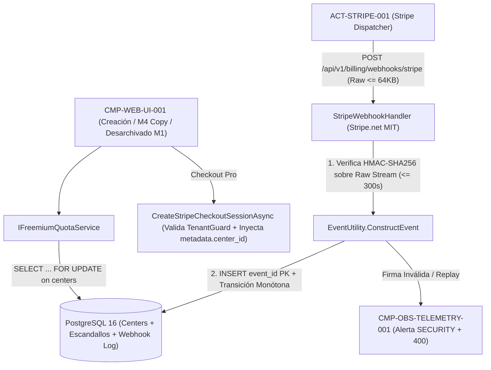

# CMP-BILLING-STRIPE-001: Gestor Atómico de Cuota Freemium y Pasarela Idempotente de Suscripciones Stripe

## 1. Propósito, Responsabilidad y Bounded Context

`CMP-BILLING-STRIPE-001` es el subsistema de monetización y control de licencias SaaS (Nivel 2) dentro de `costing-and-pricing`. Garantiza en el servidor el cumplimiento atómico multi-circuito del límite del plan gratuito (`<= 2` escandallos en estado `active` por centro, permitiendo archivar/desarchivar mediante M1 sin perder historial según `BR-FREEMIUM-QUOTA-001`), vincula en servidor el `metadata.center_id` en sesiones de **Stripe Checkout** y procesa webhooks verificados criptográficamente sobre stream crudo con `HMAC-SHA256` e idempotencia monótona (`SEC-REQ-BILLING-001`).

## 2. Diagrama de Estructura y Conectividad (arc42 Sec. 5 / NAF v4)

## 3. Contratos de Interfaz y Políticas de Ejecución

- **Control Atómico de Cuota Freemium Anti-TOCTOU Multi-Circuito (`ADR-003-MULTITENANT-RLS-AND-ATOMIC-QUOTA`, `SEC-REQ-BILLING-001`)**:
  - Antes de insertar un nuevo escandallo `active`, duplicar mediante `M4` o cambiar un escandallo de `archived` a `active` (`M1`) desde Blazor Web App o API, `IFreemiumQuotaService` abre una transacción en PostgreSQL 16 y adquiere un bloqueo pesimista exclusivo sobre la fila del centro:
    `SELECT subscription_tier FROM centers WHERE id = @centerId FOR UPDATE;`
  - Acto seguido, cuenta los escandallos activos: `SELECT COUNT(*) FROM escandallos WHERE center_id = @centerId AND status = 'active';`.
  - Si `subscription_tier == 'Free'` y `active_count >= 2`, aborta la transacción, emite un evento de auditoría `SECURITY` ante intentos concurrentes de desbordamiento de cuota y devuelve `QuotaExceededResult` (`402 Payment Required`), impidiendo que ráfagas entre pestañas/circuitos burlen el paywall (`ABUSE-QUOTA-BYPASS-001`).
- **Vinculación en Servidor de `metadata.center_id` en Checkout (`SEC-REQ-BILLING-001`)**:
  - Antes de invocar `CreateStripeCheckoutSessionAsync`, el servicio verifica mediante `ITenantIsolationGuard` que el usuario autenticado en servidor es titular del `centerId` y asigna de forma inmutable en servidor `SessionCreateOptions.Metadata["center_id"] = centerId.ToString()`, ignorando cualquier metadato enviado por el cliente.
- **Verificación Criptográfica sobre Cuerpo Crudo (`<= 64 KB`) e Idempotencia Monótona (`SEC-REQ-BILLING-001`)**:
  - El endpoint `/api/v1/billing/webhooks/stripe` limita el cuerpo crudo a $\le 64\text{ KB}$ (`MaxRequestBodySize = 65_536`) y lee directamente el stream sin mutación previa para invocar `Stripe.EventUtility.ConstructEvent(rawJson, signatureHeader, webhookSecret, tolerance: 300)` (`Stripe.net` `MIT`), rechazando con `400 Bad Request` y alerta `SECURITY` cualquier firma `HMAC-SHA256` inválida, cabecera ausente, payload alterado o timestamp con antigüedad $> 300\text{ segundos}$ (*anti-replay*).
  - Registra cada `event.Id` en `stripe_webhook_events (event_id TEXT PRIMARY KEY, center_id UUID, event_created_at TIMESTAMPTZ, processed_at TIMESTAMPTZ)` dentro de la misma transacción. Si el `event_id` ya fue procesado, devuelve `200 OK` idempotente sin re-ejecutar efectos laterales, y valida el orden temporal de la suscripción (**idempotencia monótona**) para impedir que eventos atrasados (`checkout.session.completed`) sobrescriban una cancelación más reciente (`customer.subscription.deleted`).

---

## 4. Historial de Revisiones y Control de Versiones

| Versión | Fecha | Autor / Agente | Descripción del Cambio | Referencia (Change/PR) |
| :--- | :--- | :--- | :--- | :--- |
| **1.0.0** | 2026-04-12 | `agent-system-architect` | Definición inicial del gestor atómico de cuota Freemium y Stripe HMAC-SHA256 | `chg-001-escandallo-mvp` |
| **1.1.0** | 2026-10-08 | `agent-system-architect` | Incorporación de vinculación en servidor de `metadata.center_id`, cota `<= 64 KB` sobre stream crudo e idempotencia monótona (`SEC-REQ-BILLING-001` v1.1.0) | `chg-001-escandallo-mvp` |
