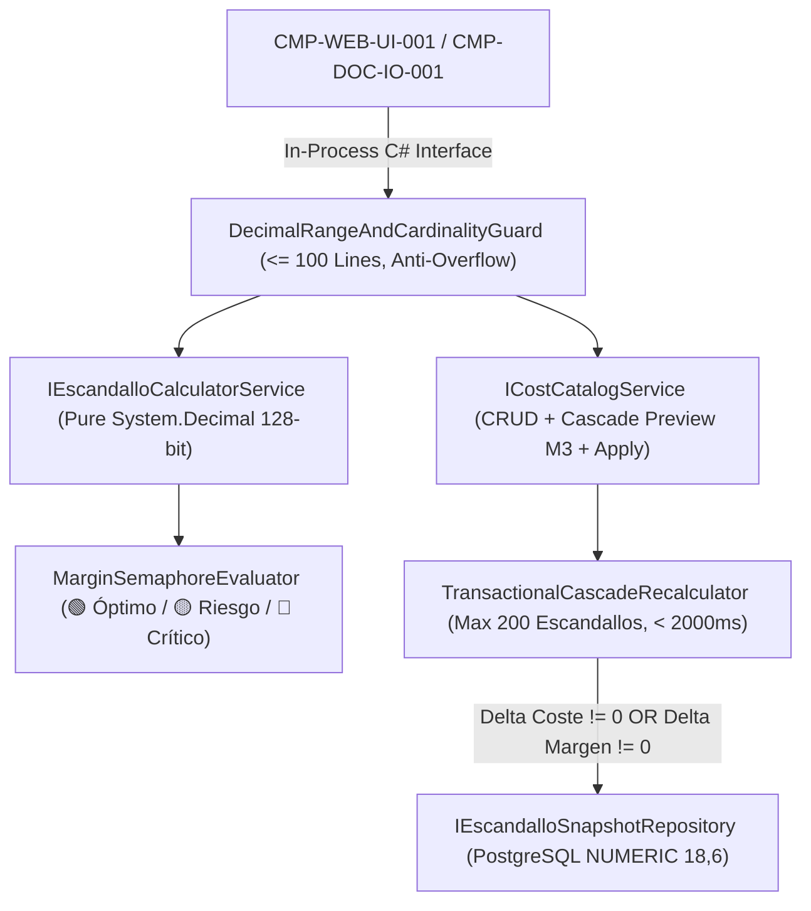

# CMP-COST-ENGINE-001: Motor de Dominio de Costes en System.Decimal (128-bit) y Recálculo Transaccional en Cascada

## 1. Propósito, Responsabilidad y Bounded Context

`CMP-COST-ENGINE-001` es la librería de dominio puro en C# (`.dll`, Nivel 2) que encapsula todas las reglas matemáticas, validaciones de rango aritmético y reglas de negocio del Bounded Context `costing-and-pricing`. Implementa el catálogo categorizado de costes (`FR-COST-001`), el motor determinista de cálculo por sesión en `System.Decimal` de 128 bits protegido contra desbordamientos (`BR-CALC-FORMULAS-001`, `FR-CALC-001`, `SEC-REQ-XLSX-001`), el Semáforo de Erosión de Margen (`🟢/🟡/🔴`), la previsualización de impacto M3 y el motor transaccional síncrono de recálculo en cascada con historial inmutable condicional (`BR-RECALC-HISTORY-001`, `FR-HIST-001`, `SEC-REQ-DOS-001`).

## 2. Diagrama de Estructura y Conectividad (arc42 Sec. 5 / NAF v4)

## 3. Contratos de Interfaz y Políticas de Ejecución

- **Mecanismo de Ejecución**: Ensamblado .NET 10 LTS de dominio puro (`Escandallo.Domain.dll`) invocado en memoria sin serialización intermedia.
- **Exactitud Matemática y Guardas Anti-`OverflowException` (`ADR-004-EXACT-DECIMAL-AND-CASCADE-ENGINE`, `SEC-REQ-XLSX-001`)**:
  - Uso exclusivo de `System.Decimal` (`128 bits`) en todos los operandos, acumuladores intermedios y resultados, con redondeo intermedio a `6` decimales (`Math.Round(val, 6, MidpointRounding.AwayFromZero)`) y redondeo de presentación monetaria a `2` decimales.
  - **Guardas de Rango de Dominio**: Antes de ejecutar multiplicaciones o divisiones en `System.Decimal` o persistir en `NUMERIC(18,6)`, el validador rechaza con `422 Unprocessable Entity` cualquier entrada no numérica (`NaN`/`Infinity`), negativa (`< 0m`), divisor igual a `0` o valor fuera de las cotas operativas (`PurchasePrice > 1_000_000m`, `UnitsPerPackage < 0.0001m`, `WastePct > 100m`, `VatPct > 100m`).
- **Previsualización M3, Cota de Líneas y Recálculo en Cascada Acotado (`BR-RECALC-HISTORY-001`, `SEC-REQ-DOS-001`)**:
  - **Cota de Cardinalidad por Escandallo (`M3`)**: Un escandallo individual **no puede superar `100 líneas de coste totales`**; cualquier intento de guardar una receta con $> 100$ líneas se rechaza con `422 Unprocessable Entity` y alerta `SECURITY`.
  - `PreviewCascadeImpactAsync`: Calcula en memoria la comparativa *Antes vs. Después* (coste anterior, nuevo coste, margen anterior, nuevo margen y transición de semáforo) para todos los escandallos vinculados al insumo modificado.
  - **Cota Anti-DoS en Cascada**: Máximo `200` escandallos afectados por operación síncrona (`< 2000 ms`) y límite de `30 mutaciones de catálogo por minuto` por inquilino. Si un insumo supera los `200` escandallos vinculados, lanza excepción controlada de protección de recursos (`CascadeBatchLimitExceededException`).
  - **Snapshots Condicionales**: Solo se inserta una nueva fila inmutable en `escandallo_snapshots` si $|\Delta \text{CosteTotal}| \ge 0.000001\text{m} \lor |\Delta \text{MargenNetoPct}| \ge 0.000001\text{m}$. Cambios cosméticos de nombre o proveedor no ensucian el historial financiero.

---

## 4. Historial de Revisiones y Control de Versiones

| Versión | Fecha | Autor / Agente | Descripción del Cambio | Referencia (Change/PR) |
| :--- | :--- | :--- | :--- | :--- |
| **1.0.0** | 2026-04-12 | `agent-system-architect` | Definición inicial del motor de costes en `System.Decimal` y cascada síncrona | `chg-001-escandallo-mvp` |
| **1.1.0** | 2026-10-08 | `agent-system-architect` | Incorporación de guardas anti-`OverflowException` en `System.Decimal` (`SEC-REQ-XLSX-001`) y cota de 100 líneas por escandallo (`SEC-REQ-DOS-001`) | `chg-001-escandallo-mvp` |
