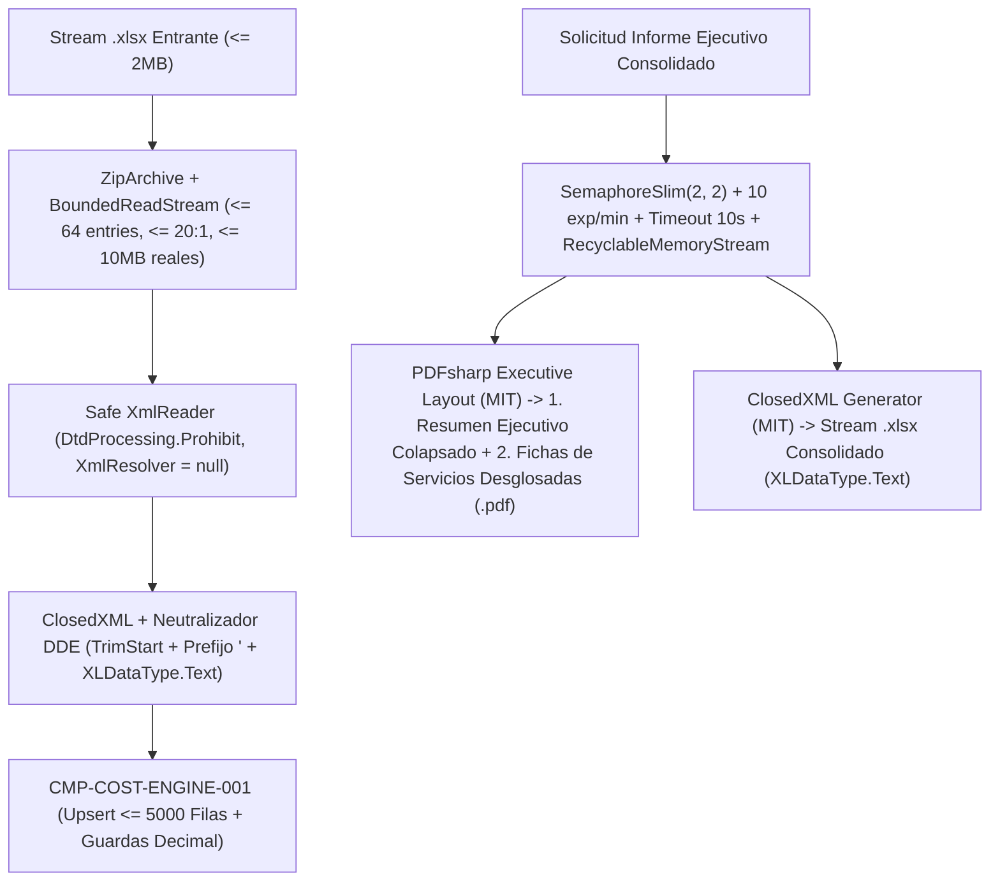

# CMP-DOC-IO-001: Motor Seguro de Importación de Catálogos (.xlsx) y Exportación Ejecutiva (.pdf / .xlsx)

## 1. Propósito, Responsabilidad y Bounded Context

`CMP-DOC-IO-001` es el servicio de entrada/salida documental (Nivel 2) dentro del Bounded Context `costing-and-pricing`. Gestiona la importación masiva de catálogos de proveedores desde archivos `.xlsx` aplicando controles estrictos contra Zip Bombs (incluido spoofing de cabeceras ZIP), XXE y Formula Injection (`SEC-REQ-XLSX-001`), y genera informes ejecutivos consolidados de rentabilidad en formato `.pdf` (maquetados para presentar a Dirección con un **Resumen Ejecutivo inicial** que recoge la información de la vista colapsada y, a continuación, un **Listado detallado de cada servicio desglosado**) y `.xlsx` (`FR-REPORT-001`) protegiendo el *Large Object Heap (LOH)* (`SEC-REQ-DOS-001`) y empleando exclusivamente librerías con licencia permisiva **`MIT`** (`ClosedXML`, `PDFsharp` y `Microsoft.IO.RecyclableMemoryStream`) conforme a `license-policy.yaml` (`ADR-005-DUAL-OBSERVABILITY-AND-SAFE-DOCUMENTS`).

## 2. Diagrama de Estructura y Conectividad (arc42 Sec. 5 / NAF v4)

## 3. Contratos de Interfaz y Políticas de Ejecución

- **Defensa Multicapa en Importación `.xlsx` (`ISafeCatalogImporter`, `SEC-REQ-XLSX-001`)**:
  1. **Validación de Cabecera y Tamaño Comprimido**: Rechazo inmediato si el stream supera `2 MB` (`2_097_152` bytes) o no inicia con los *magic bytes* ZIP (`0x50, 0x4B, 0x03, 0x04`).
  2. **Inspección Anti-Zip-Bomb y `BoundedReadStream` contra Cabeceras Falsificadas**: Apertura con `System.IO.Compression.ZipArchive` validando $\le 64$ entradas y ratio declarado `Length / CompressedLength <= 20`. Dado que `ZipArchiveEntry.Length` puede ser falsificado en la cabecera ZIP, toda descompresión se realiza a través de un stream contador acotado (`BoundedReadStream` respaldado por `RecyclableMemoryStream`) que aborta inmediatamente con `422 Unprocessable Entity` y alerta `SECURITY` si los bytes reales descomprimidos superan `10 MB`.
  3. **Bloqueo Total de XXE / DTD**: Todo parseo XML subyacente se ejecuta con `XmlReaderSettings { DtdProcessing = DtdProcessing.Prohibit, XmlResolver = null, MaxCharactersFromEntities = 1024 }`.
  4. **Cota de Filas y Neutralización DDE con `XLDataType.Text`**: Máximo `5.000` filas de datos por archivo. Cualquier celda de texto cuyo valor o su versión tras `TrimStart()` comience por `=`, `+`, `-`, `@`, tabulador (`0x09` / `\t`) o retorno de carro (`0x0D` / `\r`) recibe un apóstrofo de escape (`'`) y se marca explícitamente como literal de texto (`XLDataType.Text`) en `ClosedXML` tanto en importación como en exportación.
- **Exportación Ejecutiva Acotada, Maquetación de Dirección en PDF y Protección de LOH (`IExecutiveReportExporter`, `FR-REPORT-001`, `SEC-REQ-DOS-001`)**:
  - **Estructura y Formato Ejecutivo del PDF para Dirección (`RealPdfReportGenerator`)**:
    El documento PDF generado para todos los servicios activos del centro (`archived == false`) se maqueta con jerarquía tipográfica (`Helvetica-Bold` / `Helvetica`), cabeceras institucionales, líneas separadoras, tablas alineadas y lenguaje natural de negocio (sin enumerados internos crudos como `OPTIMO`/`ALERTA`/`CRITICO` en la presentación visual al directivo) estructurado en dos grandes secciones obligatorias:
    1. **Sección 1 — Resumen Ejecutivo Inicial (Desglose Consolidado con la Información Colapsada)**:
       - Encabezado ejecutivo con el nombre del centro de estética, fecha de emisión, parámetros financieros aplicados (`% IVA`, `% Margen Objetivo`, `% Merma`, `Tasa Gastos Generales €/min`, `Coeficiente de Empresa`) y resumen global de indicadores del centro (número de servicios activos, coste medio, precio de venta medio y beneficio neto medio).
       - **Tabla de Resumen Ejecutivo de Servicios Activos**: Contiene una fila por cada servicio activo mostrando exactamente los campos de decisión de la vista colapsada del Punto 1:
         - **Servicio** (nombre del tratamiento)
         - **Duración (`min`)**
         - **Personal asignado** (categoría profesional)
         - **Coste Total (`€`)**
         - **Precio de Venta Fijado (`€`)** (junto al **Precio Recomendado `€`**)
         - **Estado de Rentabilidad (Semáforo)** traducido a dictamen ejecutivo (*"Rentabilidad óptima"*, *"Margen ajustado"*, *"Atención: pérdida"*).
    2. **Sección 2 — Listado Detallado de Cada Servicio Desglosado para Presentar a Dirección**:
       - Para cada servicio activo del centro, presenta una **ficha ejecutiva individualizada** con:
         - **Cabecera de Ficha del Servicio**: Nombre del servicio, duración (`min`), categoría de personal asignado y dictamen del semáforo de rentabilidad.
         - **Bloque Financiero y Estructura de Costes y Márgenes**:
           - Desglose de los tres componentes del escandallo: **Coste de Productos (con merma)** (`€` y `%` sobre coste total), **Coste de Personal imputado** (`€` y `%`) y **Gastos Generales Fijos imputados** (`€` y `%`), sumando el **Coste Total del Servicio (Escandallo Total)** (`€`).
           - Comparativa ejecutiva de fijación de precios: **Beneficio Neto Objetivo (`€`)**, **Precio sin IVA (`€`)**, **Precio Recomendado con IVA (`€`)**, **Precio de Venta al Público Fijado (`€`)**, **Beneficio Neto Real (`€`)** y **Margen Neto Real (`%`)**.
         - **Tabla de Receta / Desglose de Productos Cosméticos del Servicio**: Listado detallado de cada insumo cosmético empleado en el protocolo del servicio con **Nombre del producto**, **Dosis aplicada (`ml`)**, **Formato y Precio de envase (`ml` / `€`)** y **Coste imputado por sesión con merma (`€`)**.
       - **Paginación Automática A4**: Si el contenido supera la altura útil del lienzo A4 (`595 x 842 pt`), el motor genera automáticamente páginas adicionales numeradas manteniendo el formato corporativo.
  - Concurrencia máxima de `2` generaciones simultáneas (`SemaphoreSlim(2, 2)`) y límite de `10 exportaciones por minuto` por centro (`429 Too Many Requests` con cabecera `Retry-After` y alerta `SECURITY`), con timeout duro de `10 segundos` (`CancellationTokenSource(TimeSpan.FromSeconds(10))`).
  - Reutilización de buffers mediante `Microsoft.IO.RecyclableMemoryStream` (`MIT`) para evitar fragmentación del *Large Object Heap (LOH)* (`RSK-DOC-MEM-SPIKE-003`).
  - Licencias 100% conformes con `license-policy.yaml`: `ClosedXML` (`MIT`), `PDFsharp` (`MIT`) y `Microsoft.IO.RecyclableMemoryStream` (`MIT`).

---

## 4. Historial de Revisiones y Control de Versiones

| Versión | Fecha | Autor / Agente | Descripción del Cambio | Referencia (Change/PR) |
| :--- | :--- | :--- | :--- | :--- |
| **1.0.0** | 2026-04-12 | `agent-system-architect` | Definición inicial del motor documental seguro (`ClosedXML` + `PDFsharp` MIT) | `chg-001-escandallo-mvp` |
| **1.1.0** | 2026-10-08 | `agent-system-architect` | Incorporación de `BoundedReadStream` contra cabeceras ZIP falsas, `XLDataType.Text` tras `TrimStart()` (`SEC-REQ-XLSX-001`) y protección LOH con `RecyclableMemoryStream` (`SEC-REQ-DOS-001`) | `chg-001-escandallo-mvp` |
| **1.2.0** | 2026-10-09 | `agent-system-architect` | Especificación de maquetación ejecutiva del PDF para Dirección: Sección 1 con Resumen Ejecutivo de servicios activos (datos de vista colapsada) y Sección 2 con listado de fichas desglosadas por servicio (costes, márgenes y receta de productos) (`FR-REPORT-001`) | `chg-001-escandallo-mvp` |
