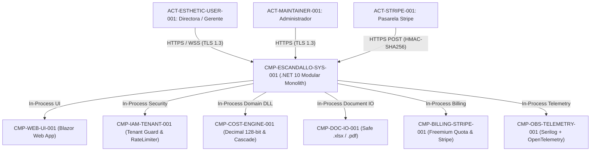

# CMP-ESCANDALLO-SYS-001: Plataforma SaaS de Escandallos para Centros de Estética (.NET 10 LTS + Blazor)

## 1. Propósito, Responsabilidad y Bounded Context

`CMP-ESCANDALLO-SYS-001` es el sistema compuesto raíz (Nivel 1) que materializa el Bounded Context `costing-and-pricing` (`TERM-ESCANDALLO-001`). Agrupa en un **Monolito Modular Hexagonal sobre .NET 10 LTS y ASP.NET Core Blazor Web App** la totalidad de capacidades de negocio, seguridad multi-tenant y observabilidad dual de la plataforma.

## 2. Diagrama de Estructura y Conectividad (arc42 Sec. 5 / NAF v4)

## 3. Contratos de Interfaz y Políticas de Ejecución

- **Mecanismo de Ejecución**: Proceso contenedorizado único `Kestrel` sobre imagen endurecida `mcr.microsoft.com/dotnet/aspnet:10.0-noble-chiseled` (`UID 1654`, *read-only rootfs*), alojado en el enclave `SEC-ENC-APP-CORE-001` detrás de `SEC-ENC-EDGE-WAF-001` (Cloudflare + Caddy mTLS con `KnownProxies`).
- **Tolerancia a Fallos, Rendimiento y Blindaje de Seguridad (`SEC-REQ-*`)**:
  - Huella de memoria acotada ($\le 2\text{ GB}$ RAM) protegida con cotas de `CircuitOptions` en SignalR ($\le 5$ circuitos/usuario, mensajes $\le 32\text{ KB}$) y `RecyclableMemoryStream` + `SemaphoreSlim(2, 2)` en generación documental (`SEC-REQ-DOS-001`).
  - Tiempo de respuesta interactivo `< 100 ms` en simulación financiera, recálculo transaccional en cascada `< 2000 ms` ($\le 200$ escandallos, máx. `30 mutaciones/minuto`) y guardas de rango en `System.Decimal` (128 bits) contra `OverflowException` (`SEC-REQ-XLSX-001`, `SEC-REQ-DOS-001`).
  - Aislamiento estricto multi-tenant respaldado por revalidación continua de `AuthenticationStateProvider` en servidor y PostgreSQL 16 (`FORCE ROW LEVEL SECURITY` *fail-closed*, rol `NOSUPERUSER NOBYPASSRLS` y `SET LOCAL app.current_center_id`) (`SEC-REQ-TENANT-001`).
  - Serialización `SELECT ... FOR UPDATE` de cuota Freemium, verificación `HMAC-SHA256` sobre cuerpo crudo ($\le 64\text{ KB}$) con idempotencia monótona en Stripe (`SEC-REQ-BILLING-001`), y telemetría dual con `ToMaximumDepth(3)`, redacción en `Exception.Message` y canal `SECURITY` inmutable (`SEC-REQ-OBS-001`).

---

## 4. Historial de Revisiones y Control de Versiones

| Versión | Fecha | Autor / Agente | Descripción del Cambio | Referencia (Change/PR) |
| :--- | :--- | :--- | :--- | :--- |
| **1.0.0** | 2026-10-08 | `agent-system-architect` | Definición inicial del componente raíz compuesto (.NET 10 LTS + Blazor) | `chg-001-escandallo-mvp` |
| **1.1.0** | 2026-10-08 | `agent-system-architect` | Integración de controles técnicos de ciberseguridad v1.1.0 (`SEC-REQ-*` sobre Blazor SignalR, Npgsql RLS, LOH, Stripe y Serilog) | `chg-001-escandallo-mvp` |
