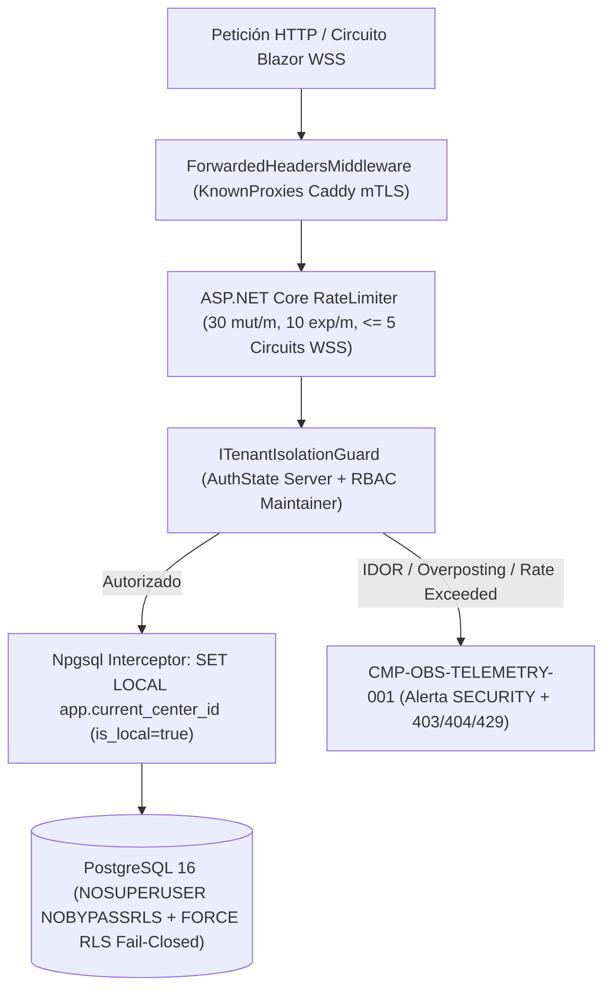

# CMP-IAM-TENANT-001: Guardia de Identidad, Aislamiento Multi-Tenant (RLS) y Limitador Anti-DoS

## 1. Propósito, Responsabilidad y Bounded Context

`CMP-IAM-TENANT-001` es el componente de seguridad transversal (Nivel 2) encargado de autenticar sesiones con ASP.NET Core Identity, hacer cumplir el aislamiento criptográfico y relacional entre centros de estética (`BR-TENANT-ISOLATION-001`, `SEC-REQ-TENANT-001`), autorizar la copia dual controlada entre locales de una misma propietaria (M4), impedir la escalada de privilegios al rol `Maintainer` (`SEC-REQ-OBS-001`) y proteger los endpoints y circuitos Blazor frente a abusos volumétricos y spoofing de IP (`SEC-REQ-DOS-001`).

## 2. Diagrama de Estructura y Conectividad (arc42 Sec. 5 / NAF v4)

## 3. Contratos de Interfaz y Políticas de Ejecución

- **Contrato `ITenantIsolationGuard` y Revalidación en Servidor (`SEC-REQ-TENANT-001`)**:
  - `EnsureCenterMembershipAsync(Guid userId, Guid centerId, CancellationToken ct)`: Extrae `userId` exclusivamente del `AuthenticationStateProvider` / `ClaimsPrincipal` en servidor (ignorando parámetros de cliente) y verifica transaccionalmente la membresía activa sobre `centerId` (todos los recursos emplean `UUIDv4`/`ULID`). Ante cualquier discrepancia, emite un evento `SECURITY` (`CROSS_TENANT_IDOR_ATTEMPT`) hacia `CMP-OBS-TELEMETRY-001` y devuelve una respuesta opaca `403 Forbidden` o `404 Not Found` sin filtrar metadatos del centro ajeno.
  - `AuthorizeDualCenterCopyAsync(Guid userId, Guid sourceCenterId, Guid targetCenterId, CancellationToken ct)`: Valida la operación `M4` exigiendo titularidad explícita simultánea en ambos centros y garantizando que la clonación de insumos o escandallos se realice **por valor** (nuevos UUIDs independientes sin referencias cruzadas).
- **Aislamiento en Pool `Npgsql` con `SET LOCAL` y `FORCE ROW LEVEL SECURITY` (`SEC-REQ-TENANT-001`, `RSK-RLS-POOL-LEAK-004`)**:
  - El rol de base de datos de la aplicación se configura estrictamente con `NOSUPERUSER NOBYPASSRLS`.
  - Cada unidad de trabajo ejecuta `SELECT set_config('app.current_center_id', @centerId::text, true);` (`is_local = true`, cuyo alcance expira al finalizar la transacción) antes de cualquier consulta, bajo políticas `ENABLE` + `FORCE ROW LEVEL SECURITY` *fail-closed* que impiden toda contaminación entre conexiones reutilizadas del pool de `Npgsql`.
- **Inmutabilidad de Rol y Ciclo de Vida de Sesión (`FR-AUTH-001`, `SEC-REQ-OBS-001`)**:
  - Bloqueo de *Mass Assignment* (*Overposting*): cualquier intento de enviar `role=maintainer` en registro o actualización de perfil es rechazado con `403 Forbidden` y alerta `SECURITY`. La verificación `[Authorize(Roles = "Maintainer")]` se ejecuta en servidor en cada acceso a `MaintainerObservabilityPage.razor` y `IObservabilityControlService`.
  - **Cierre de Sesión Determinista (`TenantAuthService.Logout` / `POST /api/auth/logout`)**: Revoca inmediatamente el token activo en el almacén de sesiones del servidor, expira la cookie `HttpOnly` (`escandallo_session`) y retorna `(200 OK, "SESION_CERRADA")`, garantizando que cualquier petición subsiguiente sin reautenticación reciba `401 Unauthorized`.
- **Anti-Spoofing de IP y Políticas de Rate Limiting (`SEC-REQ-DOS-001`)**:
  - `ForwardedHeadersMiddleware` acepta `X-Forwarded-For` / `CF-Connecting-IP` exclusivamente desde la IP interna del proxy Caddy autenticado por mTLS (`KnownProxies`).
  - **Mutaciones de catálogo con recálculo en cascada**: Máximo `30 mutaciones / minuto / tenant` (`429 Too Many Requests` + alerta `WARN`).
  - **Exportación ejecutiva `.pdf`/`.xlsx` e importación `.xlsx`**: Máximo `10 operaciones / minuto / tenant` (`429 Too Many Requests` con cabecera `Retry-After` + alerta `SECURITY`).
  - **Circuitos Blazor SignalR (`/_blazor`)**: Máximo `5 circuitos WSS simultáneos / usuario` (`429 Too Many Requests` + alerta `SECURITY`).

---

## 4. Historial de Revisiones y Control de Versiones

| Versión | Fecha | Autor / Agente | Descripción del Cambio | Referencia (Change/PR) |
| :--- | :--- | :--- | :--- | :--- |
| **1.0.0** | 2026-04-12 | `agent-system-architect` | Definición inicial del guardia multi-tenant RLS, copia M4 y limitador anti-DoS | `chg-001-escandallo-mvp` |
| **1.1.0** | 2026-10-08 | `agent-system-architect` | Alineación con `SEC-REQ-TENANT-001`, `SEC-REQ-DOS-001` y `SEC-REQ-OBS-001` v1.1.0 (`SET LOCAL` + `NOBYPASSRLS`, `KnownProxies`, 30 mut/min, 5 circuitos WSS y anti-Overposting) | `chg-001-escandallo-mvp` |
| **1.2.0** | 2026-10-09 | `agent-system-architect` | Formalización del contrato de revocación de sesión `TenantAuthService.Logout` (`SESION_CERRADA`) en `FR-AUTH-001` | `chg-001-escandallo-mvp` |
