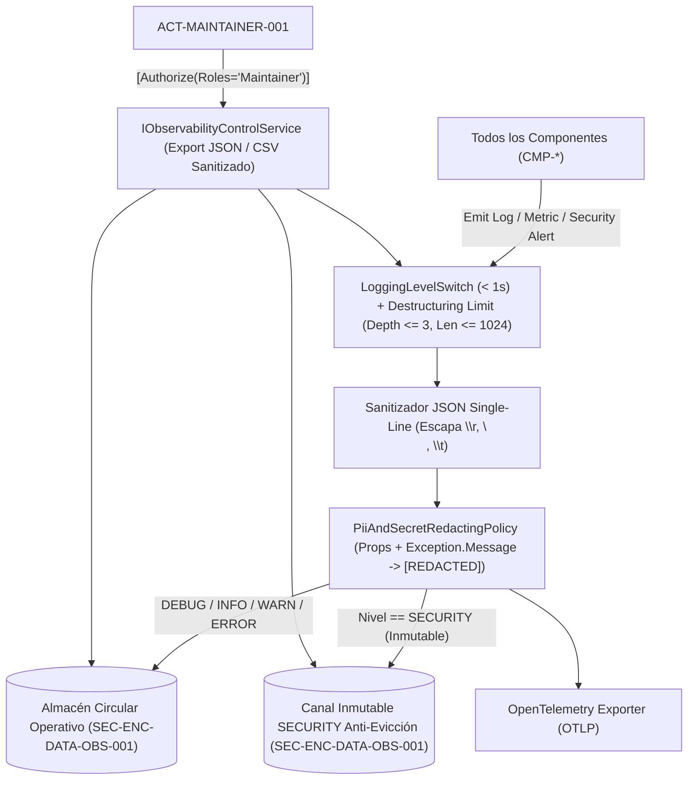

# CMP-OBS-TELEMETRY-001: Subsistema de Observabilidad Dual en Caliente, Redacción PII ([REDACTED]) y Exportación

## 1. Propósito, Responsabilidad y Bounded Context

`CMP-OBS-TELEMETRY-001` es el subsistema transversal de telemetría operativa y auditoría de seguridad (Nivel 2, alojado lógicamente en el enclave `SEC-ENC-DATA-OBS-001`). Construido sobre **`Serilog` (`Apache-2.0`)** y **`OpenTelemetry .NET` (`Apache-2.0`)**, permite al administrador (`ACT-MAINTAINER-001`) conmutar en caliente el nivel de detalle (`DEBUG`, `INFO`, `WARN`, `ERROR`, `SECURITY`) sin reiniciar el servidor y exportar registros estructurados (`JSON`, `CSV`, `OTLP`), garantizando mediante límites de destructuración (`ToMaximumDepth(3)`), un filtro inmutable sobre propiedades y `Exception.Message`, y un canal aislado para eventos `SECURITY` que **ningún secreto ni dato personal (PII) sea jamás registrado en claro** (`[REDACTED]`) ni las trazas forenses puedan ser eviccionadas (`SEC-REQ-OBS-001`).

## 2. Diagrama de Estructura y Conectividad (arc42 Sec. 5 / NAF v4)

## 3. Contratos de Interfaz y Políticas de Ejecución

- **RBAC Estricto y Conmutación Dinámica de Nivel en Caliente (`FR-OBS-001`, `SEC-REQ-OBS-001`)**:
  - `IObservabilityControlService` exige verificación en servidor `[Authorize(Roles = "Maintainer")]` en cada invocación (`SetMinimumLogLevel`, consulta y exportación `GET /admin/observability/export`), rechazando con `403 Forbidden` y alerta `SECURITY` cualquier intento no autorizado.
  - Expone `SetMinimumLogLevel(ObservabilityLogLevel level)` respaldado por `Serilog.Core.LoggingLevelSwitch` e `IOptionsMonitor`. El cambio surte efecto en `< 1000 ms` sin perder sesiones Blazor activas ni reiniciar el contenedor, y cada cambio de nivel emite un registro obligatorio con severidad `SECURITY`.
- **Cota de Destructuración y Filtro Inmutable `[REDACTED]` en Propiedades y `Exception.Message` (`SEC-REQ-OBS-001`)**:
  - Cuando `LoggingLevelSwitch` opera en `DEBUG` (y en todos los niveles), `Serilog` aplica `Destructuring.ToMaximumDepth(3)` y `ToMaximumStringLength(1024)` para impedir bombas de destructuración o referencias circulares.
  - `PiiAndSecretRedactingPolicy` (`IDestructuringPolicy` + `ILogEventEnricher`) inspecciona recursivamente propiedades estructuradas (`password`, `passwd`, `secret`, `token`, `jwt`, `authorization`, `cookie`, `set-cookie`, `credential_hash`, `stripe_signature`, `api_key`, `iban`, `card_number`, `cvv`, `email`, `phone`, `nif`, `cif`, `dni`) y aplica expresiones regulares sobre **`Exception.Message` y `ToString()`** para ofuscar con `"[REDACTED]"` cadenas de conexión `Npgsql` (`Password=...`) y secretos de Stripe (`whsec_...`, `sk_...`) antes de exportar a `JSON`/`CSV`/`OTLP`.
- **Saneamiento Anti-Log-Injection y Canal Inmutable para Eventos `SECURITY` (`SEC-REQ-OBS-001`)**:
  - Todas las entradas de log se serializan como JSON estructurado de una sola línea escapando `\r`, `\n` y `\t` para impedir falsificación de registros (*Log Forgery*).
  - Los eventos de severidad `SECURITY` (intentos IDOR, *Mass Assignment* de rol, fallos de firma Stripe, archivos `.xlsx` rechazados por Zip Bomb/XXE, excesos de cuota/rate limit y cambios de `LoggingLevelSwitch`) nunca se silencian y se persisten en un **canal/almacén dedicado e inmutable (`SecurityAuditBuffer`)** separado del buffer operativo, garantizando que una inundación de logs `DEBUG`/`INFO` no pueda rotar ni sobrescribir las evidencias de seguridad.

---

## 4. Historial de Revisiones y Control de Versiones

| Versión | Fecha | Autor / Agente | Descripción del Cambio | Referencia (Change/PR) |
| :--- | :--- | :--- | :--- | :--- |
| **1.0.0** | 2026-04-12 | `agent-system-architect` | Definición inicial de observabilidad dual en caliente y redactor `[REDACTED]` | `chg-001-escandallo-mvp` |
| **1.1.0** | 2026-10-08 | `agent-system-architect` | Incorporación de `ToMaximumDepth(3)`, redacción en `Exception.Message` (`Password=...`, `whsec_`) y canal inmutable `SECURITY` anti-evicción (`SEC-REQ-OBS-001` v1.1.0) | `chg-001-escandallo-mvp` |
