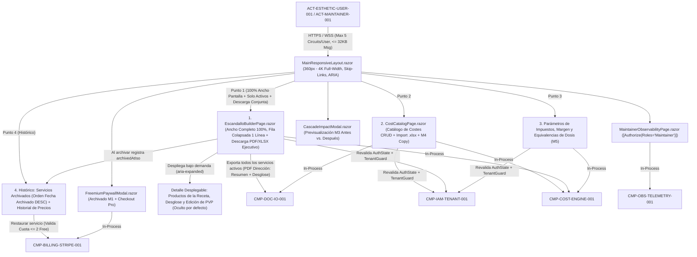

# CMP-WEB-UI-001: Interfaz Web Adaptativa en ASP.NET Core Blazor Web App (WCAG 2.1 AA)

## 1. Propósito, Responsabilidad y Bounded Context

`CMP-WEB-UI-001` es el subsistema de presentación e interacción (Nivel 2) construido de forma nativa en **ASP.NET Core Blazor Web App (.NET 10 LTS)**. Proporciona una experiencia de usuario adaptativa (*Mobile-First* desde `360px` hasta monitores `4K`) y plenamente accesible (**WCAG 2.1 AA**) para que la directora del centro (`ACT-ESTHETIC-USER-001`) simule y consulte en primer lugar sus **servicios activos** aprovechando el **100% del ancho de la pantalla** en el Punto 1 con el Semáforo de Erosión de Margen (`🟢/🟡/🔴`) mediante filas colapsadas de **una sola línea** adaptadas al tamaño de pantalla y descarga conjunta de informes ejecutivos (`.pdf` maquetado para Dirección con resumen ejecutivo inicial y fichas desglosadas por servicio, y `.xlsx`) de todos los servicios de un golpe, gestione su catálogo de costes, configure impuestos y equivalencias de dosis de cabina, consulte en la sección de histórico los **servicios archivados ordenados por fecha de archivado descendente** junto al historial de precios, previsualice impactos en cascada (M3) y gestione su suscripción Freemium/Pro, además de ofrecer la consola de observabilidad protegida por RBAC para `ACT-MAINTAINER-001`.

## 2. Diagrama de Estructura y Conectividad (arc42 Sec. 5 / NAF v4)

## 3. Contratos de Interfaz y Políticas de Ejecución

- **Mecanismo de Ejecución**: Renderizado híbrido **Blazor SSR** para navegación instantánea y baja huella de RAM, activando `@rendermode InteractiveServer` en el constructor interactivo de escandallos (`EscandalloBuilderPage.razor`) para recálculo de margen en `< 100 ms` al deslizar el PVP o variar mermas.
- **Jerarquía Funcional de la Página Principal, Aprovechamiento del Ancho de Pantalla en Punto 1, Fila Colapsada en Una Sola Línea y Descarga Global (`FR-CALC-001`, `FR-COST-001`, `FR-HIST-001`, `FR-REPORT-001`, `FR-BILLING-001`, `QR-UI-A11Y-001`)**:
  - **Ordenación Canónica de Secciones en la Página Principal**:
    1. **Punto 1 — Calculadora de servicios y semáforo de rentabilidad** (`EscandalloBuilderPage.razor` / `#escandallosHeading`): Ubicada en la posición prioritaria de la página principal y diseñada para **aprovechar el 100% del ancho disponible de la pantalla** (`width: 100%; max-width: 100%; grid-column: 1 / -1;`). Muestra **exclusivamente los servicios activos** (`archived == false`, estado *"En uso"*) e incluye en su cabecera las acciones globales para **descargar el informe ejecutivo de todos los servicios de un golpe** en PDF y Excel (`#btnDownloadAllPdf`, `#btnDownloadAllXlsx`).
    2. **Punto 2 — Catálogo de costes del centro** (`CostCatalogPage.razor` / `#catalogHeading`): Gestión de cosméticos y productos, personal del centro, gastos fijos del local e importación segura de hojas Excel.
    3. **Punto 3 — Impuestos, margen objetivo y equivalencias de dosis de cabina** (`#paramsHeading`): Configuración global de impuestos (IVA), margen de beneficio objetivo, jornada laboral, coeficiente de empresa, porcentaje de merma y calculadora de equivalencias de dosis de cabina (pulsaciones, gotas, cucharaditas y viales a ml/g).
    4. **Punto 4 — Histórico de servicios archivados y actualizaciones de precios** (`#historyHeading`): Contiene la subsección de **servicios archivados** (`archived == true`, ordenados por **fecha de archivado descendente**) junto con el registro histórico inmutable de cambios de precios.
    5. **Punto 5 — Diagnóstico técnico para soporte del sistema** (`#obsHeading`).
  - **Aprovechamiento Integral del Ancho de Pantalla en el Punto 1 (`.point-1-full-width` / `#workspaceMain`)**:
    - El contenedor principal autenticado (`#workspaceMain.container` / `.escandallo-main-viewport`) elimina la restricción rígida de `max-width: 1360px` y se expande al **`100%` del ancho del viewport** (`width: 100%; max-width: 100%; padding-inline: clamp(0.75rem, 2vw, 2rem);`), garantizando que la tarjeta del **Punto 1** (`#escandallosSection` / `section[aria-labelledby="escandallosHeading"]`) ocupe de extremo a extremo todo el espacio horizontal disponible.
    - Tanto la barra de creación/simulación de nuevo servicio como la lista de tarjetas de servicios activos (`#escandallosList`) y cada fila colapsada (`.service-collapsed-row`) se extienden al `100%` del ancho interno con distribución flexible proporcional (`flex: 1 1 auto` / CSS Grid fluido), evitando espacios muertos laterales en monitores de escritorio y pantallas panorámicas sin introducir scroll horizontal (`scrollWidth <= innerWidth`).
  - **Componente de Servicio Colapsado en Una Sola Línea Adaptativa (Punto 1)**:
    - En la lista principal (`#escandallosList`) **solo se renderizan los servicios activos** (`archived == false`), cada uno como un componente `
` de ancho completo (`width: 100%`) cerrado por defecto cuya cabecera `
` ocupa **una sola línea horizontal** (`width: 100%; display: flex; align-items: center; justify-content: space-between; flex-wrap: nowrap;`):
      - **En pantalla móvil (`< 768px`)**: La línea única muestra de forma concisa y sin desbordamiento horizontal los 4 datos esenciales de decisión: **Nombre del servicio**, **Coste total** (`€`), **Precio de venta** (`€`) y **Semáforo de rentabilidad** (`🟢/🟡/🔴`).
      - **En pantallas más grandes (`>= 768px`, Tablet y Escritorio)**: Sigue siendo de **una sola línea horizontal** distribuida a todo el ancho de la pantalla, añadiendo en la misma fila el **Tiempo** (`min`), el **Personal** asignado (categoría profesional) y los botones de acción rápida **Duplicar servicio** y **Archivar servicio** (visibles en la fila mediante `.desktop-tablet-only`).
    - **Ocultación Inicial de Productos y Panel Desplegable**: Mientras el componente permanece colapsado, el desglose detallado de costes, el listado de productos cosméticos de la receta y el control de edición del PVP permanecen ocultos, mostrándose únicamente cuando el usuario despliega la fila (`
` / `aria-expanded="true"`).
  - **Descarga Conjunta de Informes Ejecutivos Maquetados para Dirección (`FR-REPORT-001`)**:
    - Las opciones de descarga (`Descargar PDF de todos los servicios` y `Descargar XLSX de todos los servicios`) se ubican a nivel general en la cabecera del Punto 1 (`#escandallosHeading`), invocando `/api/reports/pdf?centerId={centerId}` y `/api/reports/xlsx?centerId={centerId}` para exportar en un único documento consolidado todos los servicios activos del centro.
    - El PDF generado por `CMP-DOC-IO-001` ofrece una **maquetación ejecutiva para presentar a Dirección**, compuesta en primer lugar por un **Resumen Ejecutivo** con la tabla consolidada de todos los servicios activos (mostrando la información de la vista colapsada: servicio, duración, personal, coste total, precio de venta y estado de rentabilidad) y, a continuación, un **Listado Desglosado de cada Servicio** con sus costes imputados (productos con merma, personal, gastos generales), márgenes (objetivo vs. real, precio sin IVA, PVP recomendado vs. PVP comercial) y el detalle línea a línea de los productos cosméticos de su receta.
  - **Histórico de Servicios Archivados Ordenados por Fecha de Archivado Descendente (Punto 4)**:
    - Cuando el usuario archiva un servicio activo, el sistema asigna la marca temporal exacta de archivado (`archivedAtIso` / `archived_at` en formato UTC ISO-8601), retira el servicio de la calculadora principal (Punto 1) y lo traslada a la sección de histórico (Punto 4).
    - En la sección de histórico, los servicios archivados (`archived == true`) se muestran **ordenados por fecha de archivado descendente** (`archived_at DESC`, primero el archivado más recientemente), con sus productos colapsados por defecto en una sola línea y la acción **"Restaurar servicio"** (que verifica la cuota de $\le 2$ servicios activos en plan gratuito antes de devolverlo al Punto 1 y limpiar `archivedAtIso`).
- **Blindaje de Seguridad en Componentes Razor y Circuitos SignalR (`SEC-REQ-TENANT-001`, `SEC-REQ-DOS-001`, `SEC-REQ-OBS-001`)**:
  - **Revalidación Continua Anti-Tampering de Parámetros (`SEC-REQ-TENANT-001`)**: En cada evento de componente interactivo (`InvokeSaveEscandallo`, mutación de catálogo, clonado `M4`) o envío de formulario SSR, el componente obtiene el `userId` exclusivamente del `AuthenticationStateProvider` en servidor e invoca `ITenantIsolationGuard.EnsureCenterMembershipAsync` antes de ejecutar lógica de negocio, sin confiar jamás en valores de `[Parameter]` o `[SupplyParameterFromForm]` recibidos desde el cliente tras `OnInitializedAsync`.
  - **Cotas de Circuitos Blazor SignalR (`/_blazor`) y Líneas por Servicio (`SEC-REQ-DOS-001`, `RSK-BLAZOR-CIRCUIT-001`)**: `CircuitOptions` impone `DisconnectedCircuitRetentionPeriod = TimeSpan.FromMinutes(3)`, `MaxBufferedUnacknowledgedRenderBatches = 10` y `HubOptions.MaximumReceiveMessageSize = 32 * 1024` (`32 KB`), limitando a un máximo de `5 circuitos simultáneos por usuario` (`429 Too Many Requests` + alerta `SECURITY`) y acotando cada escandallo en `EscandalloBuilderPage.razor` a un máximo de `100 líneas de coste totales` (`M3`, `422 Unprocessable Entity`).
  - **Autorización Estricta de Mantenedor y Anti-Overposting (`SEC-REQ-OBS-001`)**: `MaintainerObservabilityPage.razor` exige `[Authorize(Roles = "Maintainer")]` revalidando el `ClaimsPrincipal` en servidor en cada acción, y los formularios de registro/perfil usan DTOs de entrada cerrados que ignoran o rechazan (`403 Forbidden`) cualquier atributo `role` (*Mass Assignment*).
- **Accesibilidad, Diseño Adaptativo y Lenguaje Natural de Usuario (`QR-UI-A11Y-001`)**:
  - **Cero Scroll Horizontal y Ancho Completo en Punto 1**: CSS Grid y Flexbox fluidos con contenedor y sección del Punto 1 al `100%` del ancho de pantalla y fila colapsada en una sola línea adaptativa (`.service-collapsed-row`) que oculta columnas secundarias en móvil (`< 768px`) y las revela en tablet/escritorio (`>= 768px`).
  - **Semántica WCAG 2.1 AA**: Contraste cromático $\ge 4.5:1$ en texto normal y $\ge 3:1$ en componentes gráficos; el Semáforo de Erosión de Margen nunca depende solo del color, incluyendo icono distintivo (`🟢`/`🟡`/`🔴`), mensaje explicativo claro para el negocio (*"Rentabilidad óptima: alcanzas tu margen objetivo"* / *"Margen ajustado: ganas menos de tu objetivo"* / *"Atención: estás perdiendo dinero con este precio"*) y atributo `aria-live="polite"`.
  - **Prohibición Estricta de Nomenclatura Interna y Enumerados en la UI**: Ningún componente Razor puede renderizar códigos de requisitos o arquitectura (`FR-*`, `QR-*`, `SEC-REQ-*`, `UC-*`, `BR-*`, `M1`..`M5`, `CMP-*`), nombres de propiedades en inglés ni literales crudos de enumerados (`OPTIMO`, `ALERTA`, `CRITICO`, `active`, `archived`, `none`, `canceled`, `producto`, `gasto_general`). Todos los valores internos deben traducirse a textos significativos para el usuario final (p. ej. *"En uso"*, *"Archivado"*, *"Plan Gratuito"*, *"Suscripción Pro activa"*, *"Suscripción cancelada"*).
  - **Navegación por Teclado y Cierre de Sesión Accesible**: Gestión determinista del foco (`FocusTrap`) en los diálogos de confirmación de actualización de precios (`CascadeImpactModal.razor`) y de gestión de suscripción (`FreemiumPaywallModal.razor`) con cierre mediante tecla `Escape`. La cabecera principal (`MainResponsiveLayout.razor`) incluye de forma visible y accesible el botón **"Cerrar sesión"** (`>= 44x44 px`, `aria-label="Cerrar sesión y volver a la pantalla de acceso"`), que al accionarse revoca la sesión en servidor, purga los datos renderizados del centro activo y devuelve al usuario a la pantalla de inicio de sesión (`#authGateSection`).

---

## 4. Historial de Revisiones y Control de Versiones

| Versión | Fecha | Autor / Agente | Descripción del Cambio | Referencia (Change/PR) |
| :--- | :--- | :--- | :--- | :--- |
| **1.0.0** | 2026-04-12 | `agent-system-architect` | Definición inicial del subsistema UI en Blazor Web App (WCAG 2.1 AA) | `chg-001-escandallo-mvp` |
| **1.1.0** | 2026-10-08 | `agent-system-architect` | Incorporación de controles `SEC-REQ-TENANT-001`, `SEC-REQ-DOS-001` y `SEC-REQ-OBS-001` y regla de textos significativos de usuario sin enumerados ni códigos internos | `chg-001-escandallo-mvp` |
| **1.2.0** | 2026-10-09 | `agent-system-architect` | Inclusión explícita del botón accesible "Cerrar sesión" en `MainResponsiveLayout.razor` con retorno a la pantalla de login y limpieza de estado (`FR-AUTH-001`) | `chg-001-escandallo-mvp` |
| **1.3.0** | 2026-10-09 | `agent-system-architect` | Reordenación de la página principal (Punto 1: Calculadora de servicios; Punto 2: Catálogo de costes; Punto 3: Impuestos y equivalencias) y diseño de servicios colapsados por defecto mostrando solo resumen y ocultando sus productos (`FR-CALC-001`, `FR-COST-001`, `QR-UI-A11Y-001`) | `chg-001-escandallo-mvp` |
| **1.4.0** | 2026-10-09 | `agent-system-architect` | Segregación estricta de servicios activos en la calculadora principal (Punto 1) y traslado de servicios archivados a la sección de histórico (Punto 4) ordenados por fecha de archivado descendente (`FR-CALC-001`, `FR-HIST-001`, `FR-BILLING-001`) | `chg-001-escandallo-mvp` |
| **1.5.0** | 2026-10-09 | `agent-system-architect` | Componente de servicio colapsado en una sola línea (en móvil: nombre, coste total, precio de venta y semáforo; en pantallas mayores añade tiempo, personal, duplicar y archivar en la misma línea) y descarga conjunta PDF/XLSX de todos los servicios de un golpe (`FR-CALC-001`, `FR-REPORT-001`, `QR-UI-A11Y-001`) | `chg-001-escandallo-mvp` |
| **1.6.0** | 2026-10-09 | `agent-system-architect` | Aprovechamiento del 100% del ancho de pantalla en el Punto 1 (`.point-1-full-width` / `.container` fluido) y alineación con el formato ejecutivo del PDF para Dirección (`FR-CALC-001`, `FR-REPORT-001`, `QR-UI-A11Y-001`) | `chg-001-escandallo-mvp` |
